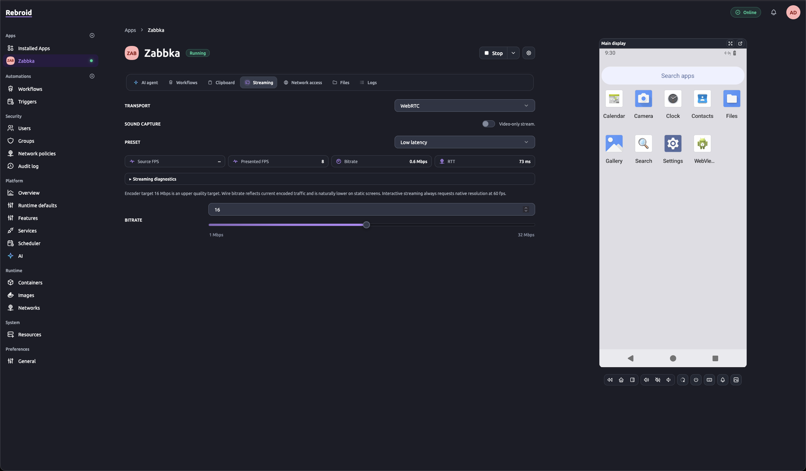
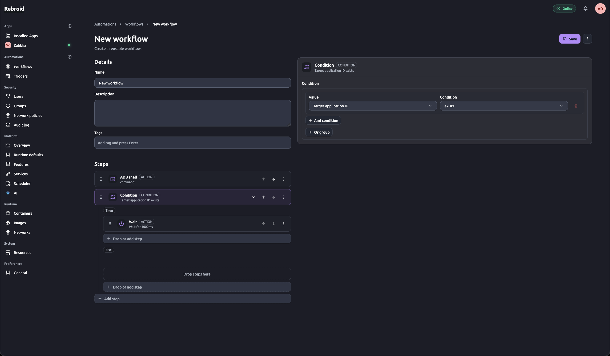
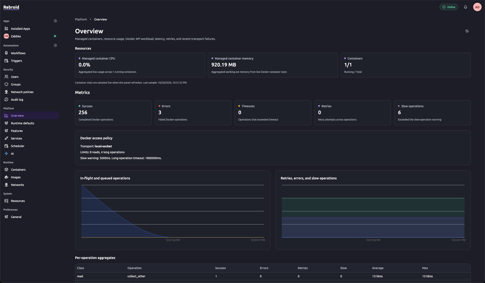
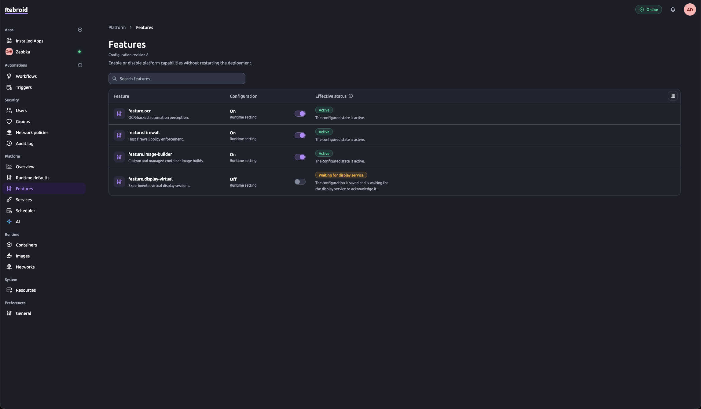

# Rebroid

**Self-hosted Android apps, controlled from your browser.**

Rebroid runs Android applications in [ReDroid](https://github.com/remote-android/redroid-doc) containers
on your Linux host. Upload an APK, open its live display, and interact with it from a browser.
Build repeatable workflows or connect an AI provider to carry out tasks on the device.

It brings application management, live control, automation, and host administration into one web UI.
Use it for remote Android workspaces, manual app testing, and automating repetitive app tasks on a single host.

[Get started](#get-started) · [Features](#what-you-can-do) · [Screenshots](#screenshots) · [Documentation](#documentation) · [Development](#development)



*A live Android workspace with streaming settings and device controls in the browser.*

> **Pre-release:** Rebroid is under active development. Database schema changes can require a
> clean-state reset; existing data is not automatically migrated. See the
> [state and upgrade notes](docs/operations.md#stored-state) before updating a deployment.

## What you can do

- **Run Android apps.** Upload APKs, create applications, start and stop them, and configure
  runtime images, display settings, CPU, and memory limits.
- **Control apps in the browser.** Use a live scrcpy display over WebRTC or WebSocket, with touch,
  keyboard, and clipboard controls. Transfer files and browse the application's `/data` volume.
- **Automate repeatable work.** Build workflows visually or edit YAML, configure scheduled triggers,
  and inspect execution traces and run history.
- **Give an AI a device task.** Connect a local or remote provider using OpenAI-compatible chat
  completions or native Ollama. Device automation uses screenshots, UI evidence, and OCR to ground
  actions. AI features require a configured provider; ordinary app control does not.
- **Manage network access.** Apply outbound network policies to running applications through
  a dedicated host firewall agent.
- **Administer a shared installation.** Manage users, groups, permissions, optional two-factor
  authentication, and audit logs. Inspect containers, images, networks, and system resources.

For apps that need Google services, the managed image builder can create local Android 13/14
images with Google Play components. See [Google Play image patching](docs/operations.md#google-play-image-patching)
for requirements and limitations.

## Screenshots

<details>
<summary>Explore the workflow editor, platform overview, and feature controls</summary>

### Visual workflow editor

Compose actions, conditions, and waits, then configure each step alongside the workflow.



### Platform overview

Monitor container resource usage, Docker operations, errors, and slow requests from one dashboard.



### Feature controls

Enable or disable platform capabilities and inspect their effective status without restarting the deployment.



</details>

## Get started

### Requirements

- A **native Linux host** with a **rootful Docker Engine** and Docker Compose.
- Android binder support on the host, as required by ReDroid. See the
  [host checks](docs/deployment.md#redroid-host-checks).
- An **x86-64 / amd64** deployment host for the supplied Compose stack.
- Internet access for the initial container builds and runtime image downloads.

Rootless engines, Docker Desktop, and Podman machine are unsupported deployment targets.
Native Linux rootful Podman with Netavark is an alternative; see the
[Podman setup notes](docs/deployment.md#podman-socket).

### Start the stack

```bash
git clone https://github.com/maeek/rebroid.git
cd rebroid
docker compose -f deploy/compose.yaml up -d --build
```

Once the stack is ready, open **[https://localhost:3443](https://localhost:3443)**.
The first build can take a while, including the OCR runtime dependencies.

The default Compose setup generates its own internal secrets and a self-signed TLS certificate,
and persists them in Docker volumes. No `.env` file is required. Your browser will report that
the certificate is not trusted; the [HTTPS guide](docs/deployment.md#local-https) explains how
to trust it and configure a LAN hostname or IP.

### Sign in and run your first app

Read the generated initial password:

```bash
docker compose -f deploy/compose.yaml exec web cat /app/data/initial-admin-password
```

Sign in as **`admin`** and replace the initial password when prompted. The generated password is
stored in a protected file and is never printed to container logs.

1. Open **Installed Apps** and create an application with your APK.
2. Use a supported Android 13 or 14 runtime image. The default is Android 14.
3. Start the application and open its live viewer.
4. For repeatable tasks, create a workflow under **Automations**. Configure a provider in
   **Platform → AI** to use AI-assisted tasks.

Live display streaming supports **ReDroid 13 and 14**. ReDroid 15 and 16 are currently blocked
because of video startup compatibility issues. See the
[streaming compatibility notes](docs/deployment.md#redroid-display-streaming-support).

### Common configuration

Most runtime settings are managed in the UI. These environment variables cover common deployment changes:

| Variable | Default | Purpose |
| --- | --- | --- |
| `REBROID_HTTPS_PORT` | `3443` | Published HTTPS port. |
| `REBROID_TLS_HOSTS` | `localhost,127.0.0.1` | Hostnames and IPs included in the generated certificate. |
| `REBROID_PUBLIC_HOSTS` | Falls back to TLS hosts | Browser hostnames accepted by the edge proxy. |
| `CONTAINER_ENGINE_SOCKET` | `/var/run/docker.sock` | Rootful container engine socket. |
| `DISPLAY_WEBRTC_UDP_PORT_RANGE` | `40000-40100` | Published WebRTC media ports. |
| `DISPLAY_WEBRTC_ICE_HOST` | Automatic | Advertised WebRTC host when automatic discovery is unsuitable. |

For LAN access, configure the certificate host list before the first start:

```bash
REBROID_TLS_HOSTS=192.168.1.11,localhost,127.0.0.1 \
  docker compose -f deploy/compose.yaml up -d --build
```

The HTTPS edge is the browser entry point. The orchestrator, web backend, and OCR API stay on the
internal network; WebRTC also uses the published UDP range. The stack controls privileged Android
containers and the host firewall, so run it on a host you administer. See
[deployment](docs/deployment.md) for reverse proxy, firewall, socket, and host configuration.

## How it works

Rebroid is a single-host system with separate services for application lifecycle, display sessions,
and host firewall rules.

| Component | Responsibility |
| --- | --- |
| **Edge** | nginx HTTPS ingress for the UI, viewer assets, and streaming connections. |
| **Web** | Next.js UI, authentication, permissions, and browser-facing backend. |
| **Orchestrator** | NestJS API for Android lifecycle, Docker operations, workflows, and settings. |
| **Display sidecar** | ADB, scrcpy, viewer sessions, and WebRTC/WebSocket streaming. |
| **Firewall agent** | Host network policy enforcement through a private Unix socket. |
| **OCR sidecar** | PaddleOCR text recognition for automation vision. |

The web backend authorizes application access and creates short-lived viewer sessions. Display
traffic goes directly through the edge to the display sidecar, with WebRTC media flowing between
the browser and sidecar. The Next.js process does not relay media.

## Documentation

- [Deployment and local development](docs/deployment.md) — HTTPS, host requirements, Podman,
  configuration, and troubleshooting.
- [Operations](docs/operations.md) — diagnostics, stored state, image patching, and AI provider setup.
- [Architecture](docs/architecture.md) — service boundaries and execution invariants.
- [Display streaming](docs/display-streaming.md) — media transport and performance diagnostics.
- [Runtime file explorer](docs/runtime-file-explorer.md) — file operations and access rules.
- [Web security](docs/web-security.md) — authentication, sessions, permissions, and audit behavior.

## Development

The repository is a pnpm/Turbo monorepo. Use **Node.js 24** and **pnpm through Corepack**:

```bash
corepack enable
pnpm install
pnpm check
```

`pnpm check` runs formatting, linting, type checks, tests, contract and dependency checks, and production
builds. For starting individual services and setting local secrets, follow the
[local development guide](docs/deployment.md#local-development).

| Path | Contents |
| --- | --- |
| [`apps/web`](apps/web) | Next.js UI and backend-for-frontend. |
| [`apps/orchestrator`](apps/orchestrator) | Android lifecycle and automation control plane. |
| [`apps/display-sidecar`](apps/display-sidecar) | ADB and live display service. |
| [`apps/firewall-agent`](apps/firewall-agent) | Host firewall reconciler. |
| [`apps/ocr-sidecar`](apps/ocr-sidecar) | Python OCR service. |
| [`packages`](packages/README.md) | Shared domain libraries and generated API contracts. |
| [`deploy`](deploy) | Compose stack, ingress, and image transfer scripts. |

Before contributing, read the [repository instructions](AGENTS.md) and the architecture guide for
the area you are changing. Web contributors should also read the
[web contributor guide](docs/web-contributor-guide.md).

Generated OpenAPI contracts live in the two `*-contracts` packages. Change the owning DTO/controller,
then run `pnpm openapi:generate`; do not edit generated `schema.ts` files directly.

## Built on

Rebroid brings together [ReDroid](https://github.com/remote-android/redroid-doc),
[scrcpy](https://github.com/Genymobile/scrcpy), and [PaddleOCR](https://github.com/PaddlePaddle/PaddleOCR).
The optional Google Play image builder uses [MindTheGapps](https://github.com/MindTheGapps).
Google components are built locally from upstream packages; Rebroid does not redistribute patched
images or guarantee Play Protect certification or Play Integrity compatibility.
