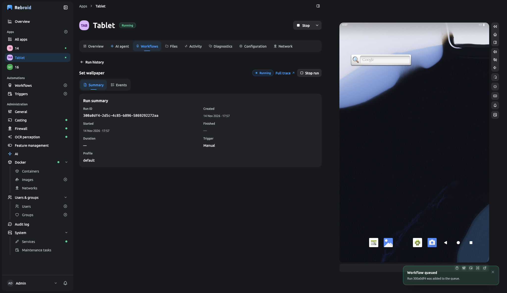
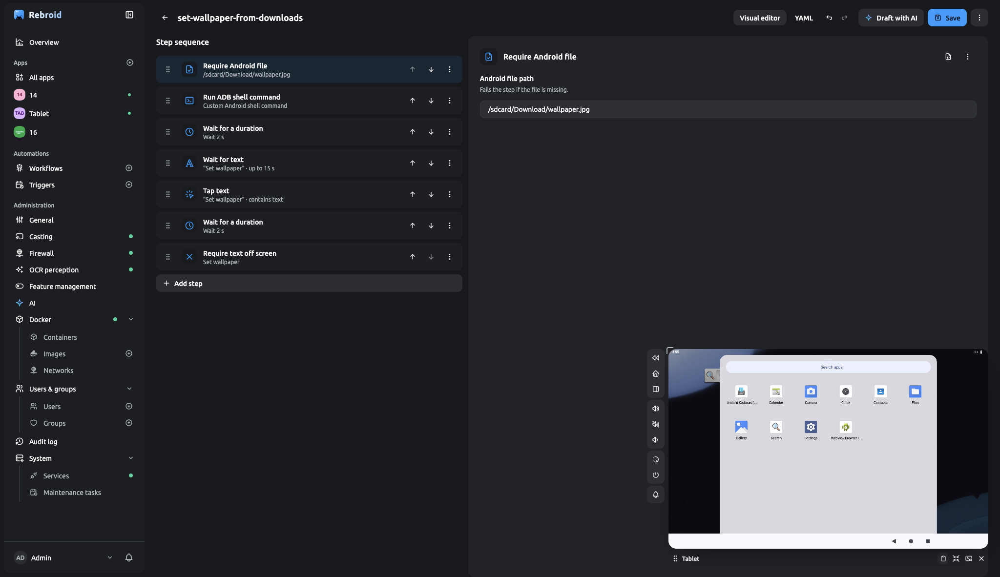
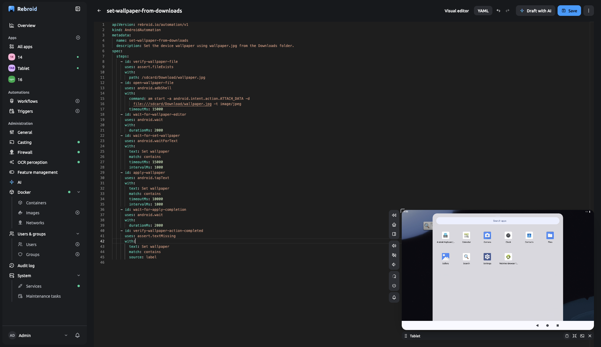
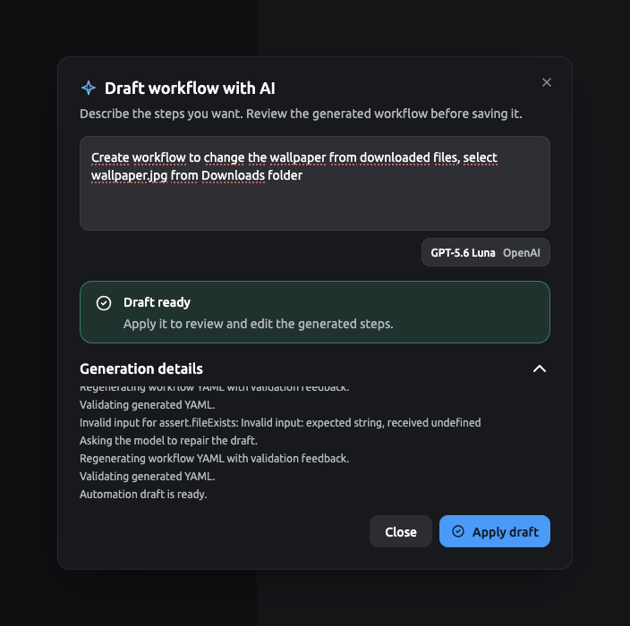

# Rebroid

**Run Android apps on your own Linux host and control them from your browser.**

Rebroid manages ReDroid containers for remote Android workspaces and app testing. Open a live display, keep app data in persistent profiles, and turn repeatable device tasks into workflows.

[Quick start](#quick-start) · [Console tour](#console-tour) · [Documentation](#documentation) · [Contributing](#contributing)

## Quick start

Use a native **Linux x86-64 (amd64)** host you administer, with rootful Docker Engine, Docker Compose, and Android binder support. The stack runs privileged Android containers and manages their outbound firewall rules. Builds and runtime image downloads require internet access. [Host requirements](docs/deployment.md#host-requirements) · [Binder checks](docs/deployment.md#redroid-host-checks)

### 1. Start Rebroid

```bash
git clone https://github.com/maeek/rebroid.git
cd rebroid
docker compose -f deploy/compose.yaml up -d --build
```

The first build includes the OCR service and its dependencies. The default stack generates internal secrets and a self-signed certificate automatically. If you’ll open Rebroid from another machine, set the browser-facing hostname or IP before starting the stack. [HTTPS and LAN setup](docs/deployment.md#local-https)

### 2. Sign in

Read the initial administrator password from the web container.

```bash
docker compose -f deploy/compose.yaml exec web cat /app/data/initial-admin-password
```

On the host, open [https://localhost:3443](https://localhost:3443). Use the [HTTPS guide](docs/deployment.md#local-https) to trust the generated certificate, then sign in as `admin`. Replace the initial password when prompted.

### 3. Open your first Android display

1. Go to **All apps → Create app** and give the app a name.
2. Keep the default Android 14 image. To install an app at first boot, select **Upload APK** and choose its APK file.
3. Select **Create app** and watch provisioning on the app page. When Android is ready, use the live viewer. On a narrow screen, select **Device** to show it.

[See the Create app form](docs/images/create-app.webp)

The viewer accepts ReDroid 13 through 16. Check the [display and audio compatibility notes](docs/deployment.md#redroid-display-streaming-support) before choosing another image.

> **Pre-release.** A schema change can require a clean database. Review the [stored state guide](docs/operations.md#stored-state) before upgrading an existing deployment.

## Console tour

### Control a live Android display

Use touch, keyboard, and clipboard controls over WebRTC or WebSocket. The live viewer sits beside the app’s details, so you can watch Android while checking workflow activity. On desktop, the mini-player keeps the display visible as you move between pages.



### Automate a task and inspect each run

Arrange and configure steps in the visual editor. For example, wait for an Android button to appear, tap it, and check that the next screen contains the expected text. Run the workflow on demand or schedule it for a specific app and profile. Use the run history to inspect step results and events.



Select **YAML** to edit the same workflow as text.



### Run device tasks and draft workflows with AI

Enable AI in **Administration → Feature management**, then connect a hosted provider or local model server under **Administration → AI**. In a running app’s **AI agent** tab, describe a device task. The agent uses screenshots, Android UI evidence, and optical character recognition (OCR) to decide where to act. [AI provider setup](docs/operations.md#ai-provider-compatibility)

With a Planning model configured, select **Draft with AI** in the workflow editor and describe the steps you want. Apply the generated draft to review and edit the steps before saving.



## Documentation

| Guide                                          | What you’ll find                                                          |
| ---------------------------------------------- | ------------------------------------------------------------------------- |
| [Deployment](docs/deployment.md)               | Host setup, HTTPS, reverse proxies, and rootful Podman                    |
| [Operator console](docs/operator-console.md)   | App lifecycle, profiles, viewer navigation, network policy, and workflows |
| [Operations](docs/operations.md)               | Diagnostics, stored state, AI providers, and Google Play image patching   |
| [Display streaming](docs/display-streaming.md) | WebRTC, WebSocket, and viewer troubleshooting                             |
| [Architecture](docs/architecture.md)           | Service responsibilities, request and media flows, and state ownership    |
| [Web security](docs/web-security.md)           | Account sessions, permissions, and viewer authorization                   |

[Browse all documentation](docs/README.md)

## Contributing

Rebroid uses Node.js 24 and pnpm through Corepack. From the repository root, install dependencies and run the project checks.

```bash
corepack enable
pnpm install
pnpm check
```

See the [contributing guide](CONTRIBUTING.md) for local development, service verification, and pull requests.

## Built on

Rebroid uses [ReDroid](https://github.com/remote-android/redroid-doc) for Android containers, [scrcpy](https://github.com/Genymobile/scrcpy) for display capture and device control, and [PaddleOCR](https://github.com/PaddlePaddle/PaddleOCR) for text recognition. Optional [Google Play image patching](docs/operations.md#google-play-image-patching) uses [MindTheGapps](https://github.com/MindTheGapps).
