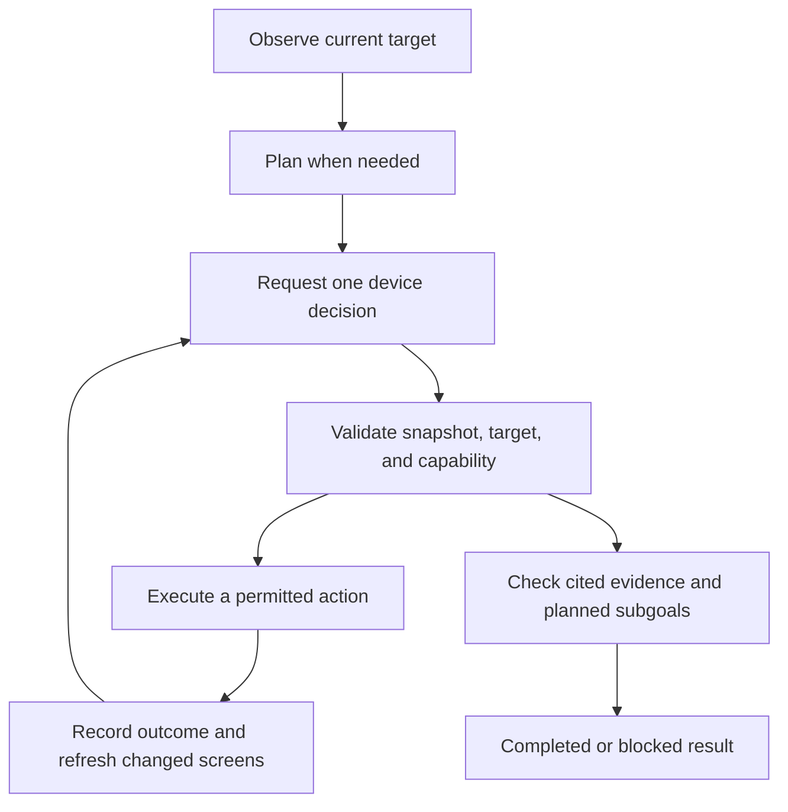

# AI automation

This directory implements Rebroid's AI-assisted Android tasks, workflow drafting, and prompt
suggestions. Device tasks run inside the normal automation runner, using its target reservation,
permissions, cancellation, and event stream.

For the surrounding services, see the [architecture overview](../../../../../docs/architecture.md).
Provider setup is covered in [Operations](../../../../../docs/operations.md#local-ai-provider-compatibility).

## Functions

| Function               | Behavior                                                                                                                                                               |
| ---------------------- | ---------------------------------------------------------------------------------------------------------------------------------------------------------------------- |
| **Device tasks**       | `ai.run` observes the Android target, requests a typed decision, validates it, executes a permitted action, and checks the result.                                     |
| **Workflow drafts**    | Generate YAML from a prompt, validate it against available commands, and request repairs or clarification when needed. Drafting does not execute the workflow.         |
| **Prompt suggestions** | Suggest tasks from the application, conversation, recent events, and allowed tools. Return deterministic suggestions if the provider fails or returns unusable output. |

Vision support lives in the sibling [`vision`](../vision) directory. It combines screenshots,
Android UI data, OCR, and optional model descriptions into the evidence used by device decisions.

## Running a device task

Configure an enabled provider/model in **Platform → AI**. Use the application's **AI agent**
workspace or add an `ai.run` step to a workflow:

```yaml
apiVersion: rebroid.io/automation/v1
kind: AndroidAutomation
metadata:
  name: Inspect Android settings
spec:
  steps:
    - id: inspect-settings
      uses: ai.run
      with:
        prompt: Open Android Settings and report the visible screen.
        agentMode: adaptive
        maxActions: 8
        timeoutMs: 60000
        rawShellPolicy: deny
```

The target is selected when the workflow runs. The caller needs `automations:run-ai` and the
permissions required by the actions it executes. `providerId` and `modelId` can select a specific
configured controller; otherwise provider selection uses the configured role defaults.

`maxActions` bounds action attempts; when omitted, `maxToolCalls` supplies the limit. The timeout
bounds the task deadline. Reaching either budget without verified completion returns a blocked
result. Cancellation and provider failures are handled through the surrounding execution path.

### Decision loop



- **Adaptive mode** uses the task's complexity and execution failures to decide when to plan.
- **Controller mode** skips initial planning.
- **Planned mode** creates an initial plan before action decisions.

The controller receives one `DeviceDecision` JSON schema, or the fallback
`submit_device_decision` tool. It does not receive the entire command registry as callable tools.

| Decision             | Meaning                                                                      |
| -------------------- | ---------------------------------------------------------------------------- |
| `act`                | Perform one typed action against the current snapshot.                       |
| `needs_plan`         | Request planning within the planner budget.                                  |
| `ask_user`           | End this run as blocked with a question; it does not suspend a running loop. |
| `request_escalation` | Request a separately validated read-only shell command.                      |
| `finish`             | Propose a completed or blocked result with evidence and subgoal references.  |

Typed actions cover taps, swipes, text entry, keys, application launch, system surfaces,
waits, and invocation of a capability routed into that run. The
[decision contract](core/device-decision.ts) is the source of truth for their shapes.

## Evidence and execution boundaries

Actions bind to the current snapshot and target fingerprint. A stale snapshot, changed target,
or capability outside the run's policy cannot execute. Taps need an observed candidate ID or
normalized coordinates; compatibility normalization may repair aliases and provider envelopes,
but must not invent a target.

After a screen-changing action, the executor observes again and records the result as evidence.
The finish verifier rejects unknown evidence/subgoal IDs, completed results without evidence,
and completion that omits planned subgoals. Results include the final text, completed/blocked
status, action count, blocked reason, and evidence references.

`android.adbShell` is excluded from ordinary routed capabilities. Escalation needs both an explicit
`rawShellPolicy: allowlisted` run policy and a validated read-only `{program, args}` command.
A chat approval creates a new one-run follow-up after the web server verifies
`automations:run-adb-shell`; it never changes persistent provider or conversation settings.
Human-authored shell workflow steps remain separately permission checked.

## Providers and perception

Provider CRUD, persistence, model roles, health checks, and downloads belong to
[`settings`](../../settings). This directory selects providers through that module's public
surface. The device harness uses the selected controller model for decisions and optional plans;
drafting and suggestions select the planner role. A separate vision provider/model is optional.

The chat client normalizes OpenAI-compatible SSE and native Ollama NDJSON, preserving content,
tool decisions, usage, finish reasons, and timing. Transport is independent from detected server
flavor. Hidden reasoning text is not persisted; only its presence is recorded.

Perception captures the screen and UI data, sends the original lossless image to the OCR adapter,
and optionally asks a vision model to describe it. Fusion ranks candidates and prepares the marked
screenshot and text summary used by the controller. OCR is feature-gated and uses the deployment's
single configured language. Capture, OCR, model description, and fusion remain separate concerns.

## Code map

| Area                                                      | Start here                                                                                                            |
| --------------------------------------------------------- | --------------------------------------------------------------------------------------------------------------------- |
| Budgets, planning policy, and main loop                   | [Harness](automation-ai-harness.service.ts).                                                                          |
| Controller/planner requests and decision retries          | [Decision service](automation-ai-decision.service.ts).                                                                |
| Action validation, execution, and post-action observation | [Action executor](automation-ai-action-executor.service.ts).                                                          |
| Target identity, capabilities, and shell allowlist        | [Agent state and policy](automation-device-agent-state.ts).                                                           |
| Typed decisions and controller/planner prompts            | [Decision contract](core/device-decision.ts), [messages](core/device-messages.ts).                                    |
| Terminal evidence checks                                  | [Finish verifier](automation-ai-finish-verifier.ts).                                                                  |
| Provider streaming                                        | [Chat client](automation-ai-chat-client.service.ts), [stream parser](core/streaming.ts).                              |
| Drafting and suggestions                                  | [YAML drafts](automation-ai-yaml-draft.service.ts), [suggestions](automation-ai-suggestions.service.ts).              |
| Observation orchestration and fusion                      | [Perception](../vision/automation-perception.service.ts), [vision facade](../vision/automation-vision.service.ts).    |
| Command registration and ad-hoc run definitions           | [`ai.run`](../commands/ai-automation-commands.service.ts), [definition factory](automation-ai-definition.factory.ts). |

## Verification

Run focused tests from the repository root:

```bash
pnpm --filter rebroid-orchestrator test --runInBand --runTestsByPath src/automations/ai/automation-ai-harness.service.spec.ts src/automations/ai/core/device-decision.spec.ts src/automations/ai/automation-ai-finish-verifier.spec.ts
```

For wider AI/perception changes:

```bash
pnpm --filter rebroid-orchestrator test --runInBand --testPathPatterns='automations/(ai|vision)/'
pnpm --filter rebroid-orchestrator typecheck
```

Use recorded SSE/NDJSON and perception fixtures. Tests must not call live language or vision models.
Add coverage at the boundary changed: stale snapshots and capabilities, decision normalization,
completion evidence, provider streams, YAML validation, or perception fusion. Follow the
[contribution guide](../../../../../CONTRIBUTING.md) for shared-contract and repository checks.
