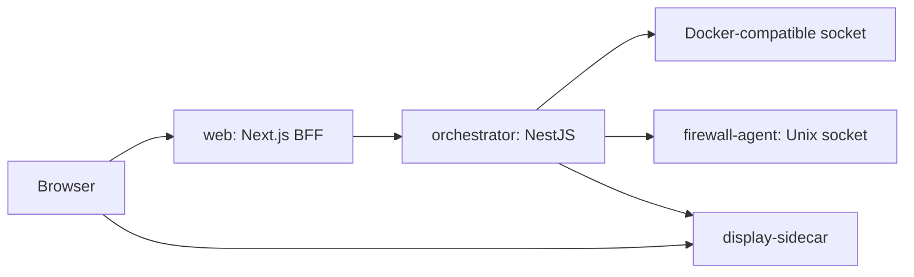

# Architecture

Rebroid is a single-host appliance. The browser communicates with the Next.js backend-for-frontend. The web service calls the internal orchestrator API, which owns persistent Android application state and talks to the Docker-compatible host socket. The firewall agent applies host rules through a private Unix socket. The display sidecar owns ADB viewer sessions and streaming.

## Boundaries

- Browser code does not call the orchestrator directly.
- Next.js `app` route files should stay thin and delegate page composition to feature `pages/*/page-entry.tsx` files. Reusable layout/status/data-grid/setting primitives live in `apps/web/src/shared/ui`, not in a feature folder.
- The orchestrator owns Android application lifecycle state. Normal application reads return stored state and never trigger Docker calls; runtime reconciliation is an explicit command exposed by the orchestrator API.
- The orchestrator keeps its existing top-level Nest module ownership. Maintainability work should split oversized files inside the owning module and expose intentional `facades` or `contracts` for cross-module use instead of importing deep implementation files.
- Inside the orchestrator `docker/sidecar` module, keep sidecar orchestration, repair, and network/ADB coordination in `DockerSidecarService`; keep image existence/build work in `DockerSidecarImageService` and pure sidecar parsing helpers under `utils`.
- Inside the orchestrator `container-images` module, keep admin image pull/build APIs, managed GApps presets, the single-job patch queue, verified package cache, safe archive extraction, image build recipes, uploaded build context files, Dockerfile validation, and Docker build job orchestration together. The GApps worker is a non-root ephemeral container with no Docker socket, application secrets, or host mounts. Runtime metadata attached to Docker images belongs in `docker/images` so inventory, builders, and Android app creation resolve image kind through one service.
- APK dependency analysis belongs to `apk`. It persists a versioned probabilistic verdict and evidence without making analysis success an upload requirement. Other modules inspect APK package names only through the public `APK_PACKAGE_INSPECTION` port.
- Inside the orchestrator `android-apps/lifecycle` module, keep `AndroidAppsLifecycleService` as the thin controller-facing facade. Configuration/profile/APK entrypoints belong to `AndroidAppsConfigurationService`; start/stop commands belong to `AndroidAppsPowerService`; startup recovery belongs to `AndroidAppsLifecycleRecoveryService`; removal retries and cleanup belong to the removal services. Provision and start share `AndroidAppsRuntimeActivationService`, while application/job state changes go through `AndroidAppsLifecycleTransitionService`.
- Inside the orchestrator `android-apps/runtime` module, keep runtime download use-case routing and running-container media-scan orchestration in `RuntimeDownloadFilesService`; keep persistent volume lookup, listing, reads, and writes in `RuntimeDownloadVolumeService`.
- Inside the orchestrator `android-apps/provisioning` module, keep provisioning orchestration in `AndroidAppsProvisioningService`, Android boot/remote-access preparation in `AndroidAppsProvisioningAndroidService`, APK install/launch orchestration in `AndroidAppsProvisioningApkService`, and pure APK shell/package-resolution plus Android boot diagnostic helpers under `provisioning/utils`.
- Inside the orchestrator `automations` domain, `AutomationsModule` composes the internal commands, events, AI/vision, execution, definition, and scheduling modules; these are code boundaries, not deployable services. `AutomationsService` remains the controller-facing facade. `AutomationRunnerService` reserves queued runs, cancels, and dispatches; `AutomationRunExecutionService` owns target preparation, step execution, terminalization, and cleanup. `AutomationAiHarnessService` owns the adaptive deadline/action loop, `AutomationAiDecisionService` owns controller/planner provider turns, and `AutomationAiActionExecutor` owns grounded action validation/execution. Vision observation flows through lossless OCR input, optional model description, fused UI/OCR/vision candidates, and a set-of-marks image before reaching the stable `AutomationVisionService` facade.
- AI provider configuration separates transport protocol from server flavor. OpenAI chat completions is the default transport for OpenAI, llama.cpp, Lemonade, and compatible servers; native Ollama chat is explicit. Stream adapters normalize public content, reasoning presence, decisions, usage, timings, and finish reasons without persisting hidden reasoning text.
- Port contracts are independent interfaces that describe only the capability a consumer needs. They must not derive their shape from concrete classes with `Pick`, `keyof`, or implementation imports. Concrete adapters implement the port and are wired to symbol tokens with `useExisting`.
- Code outside `docker` consumes Docker behavior only through tokenized ports under `docker/contracts` and imports `DockerModule` for wiring. Automations consume Android stored reads, lifecycle start, and automation adapters through the `ANDROID_APPS_AUTOMATION` token; they do not inject the Android facade or internal services directly.
- Inside the orchestrator `settings` module, keep generic orchestrator settings facade methods in `SettingsService`, persistence/default normalization in `OrchestratorSettingsStore`, AI-provider CRUD/execution lookup in `AiProviderSettingsService`, provider connectivity checks in `AiProviderHealthService`, and provider model downloads in `AiProviderModelDownloadService`.
- The display sidecar owns viewer session state. Scrcpy process/socket ordering is a protected implementation detail. Only pure SPS parsing, compatibility parsing, retry classification, and stream-option selection may be refactored without the manual Redroid harness.
- The firewall agent exposes no public TCP port.
- SQLite state is local to the owning process. It runs in WAL mode with `synchronous=NORMAL`, foreign keys enabled, and a five-second busy timeout. There is no multi-host coordination layer. The pre-release schema is created by one initialization migration and assumes a clean state volume.

## Automation execution invariants

- A target is reserved by inserting its queued run before any target preparation. The partial unique active-target index permits at most one queued or running run per target.
- Status writes are guarded transitions. Only `queued -> running` and `queued|running -> success|failed|canceled` are valid execution transitions; a terminal state is never overwritten by another terminalizer.
- Every dispatched execution has an error handler and a `finally` cleanup path. Unexpected errors persist failure, emit a terminal event, release the abort controller, and remove ephemeral definitions.
- Queued or running rows found at startup are failed with an orchestrator-restarted reason. They are never resumed because steps and ephemeral definitions are not durable enough for safe replay.
- Each run owns a persisted `lastEventSequence`. Sequence allocation and event insertion happen in one serialized SQLite transaction and are protected by a unique `(runId, sequence)` index.
- WebSocket setup subscribes before replay loading, buffers live events during replay, and emits a deduplicated ascending sequence. Subscription tokens are one-use, expire after one minute, and are bounded to 10,000 in memory.

## Local Quality Gate

Run `pnpm check` from the repository root. It performs formatting checks, linting, typechecks, tests, contract drift checks, dependency-boundary checks, dead-code analysis, and production builds.
