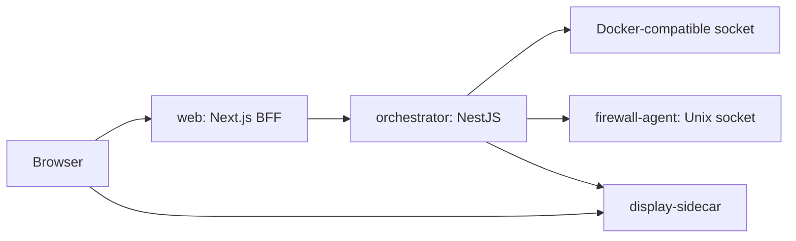

# Architecture

Rebroid is a single-host appliance. The browser communicates with the Next.js backend-for-frontend. The web service calls the internal orchestrator API, which owns persistent Android application state and talks to the Docker-compatible host socket. The firewall agent applies host rules through a private Unix socket. The display sidecar owns ADB viewer sessions and streaming.

## Boundaries

- Browser code does not call the orchestrator directly.
- The orchestrator owns Android application lifecycle state.
- The display sidecar owns viewer session state. Scrcpy process and socket ordering are treated as a protected implementation detail.
- The firewall agent exposes no public TCP port.
- SQLite state is local to the owning process. There is no multi-host coordination layer.

## Local Quality Gate

Run `pnpm check` from the repository root. It performs formatting checks, linting, typechecks, tests, contract drift checks, dependency-boundary checks, dead-code analysis, and production builds.
