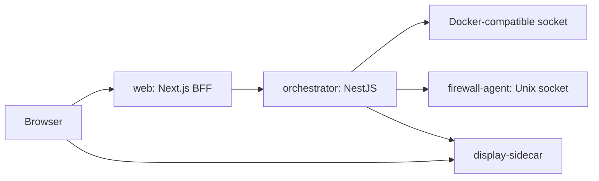

# Architecture

Rebroid is a single-host appliance. The browser communicates with the Next.js backend-for-frontend. The web service calls the internal orchestrator API, which owns persistent Android application state and talks to the Docker-compatible host socket. The firewall agent applies host rules through a private Unix socket. The display sidecar owns ADB viewer sessions and streaming.

## Boundaries

- Browser code does not call the orchestrator directly.
- Next.js `app` route files should stay thin and delegate page composition to feature `pages/*/page-entry.tsx` files. Reusable layout/status/data-grid/setting primitives live in `apps/web/src/shared/ui`, not in a feature folder.
- The orchestrator owns Android application lifecycle state.
- The orchestrator keeps its existing top-level Nest module ownership. Maintainability work should split oversized files inside the owning module and expose intentional `facades` or `contracts` for cross-module use instead of importing deep implementation files.
- Inside the orchestrator `docker/sidecar` module, keep sidecar orchestration, repair, and network/ADB coordination in `DockerSidecarService`; keep image existence/build work in `DockerSidecarImageService` and pure sidecar parsing helpers under `utils`.
- Inside the orchestrator `container-images` module, keep admin image pull/build APIs, image build recipes, uploaded build context files, Dockerfile validation, and Docker build job orchestration together. Runtime metadata attached to Docker images belongs in `docker/images` so inventory, builders, and Android app creation resolve image kind through one service.
- Inside the orchestrator `android-apps/lifecycle` module, keep HTTP-facing lifecycle orchestration in `AndroidAppsLifecycleService`; keep the long container start/image/network/readiness/APK launch background flow in `AndroidAppsStartLifecycleService`.
- Inside the orchestrator `android-apps/runtime` module, keep runtime download use-case routing and running-container media-scan orchestration in `RuntimeDownloadFilesService`; keep persistent volume lookup, listing, reads, and writes in `RuntimeDownloadVolumeService`.
- Inside the orchestrator `android-apps/provisioning` module, keep provisioning orchestration in `AndroidAppsProvisioningService`, Android boot/remote-access preparation in `AndroidAppsProvisioningAndroidService`, APK install/launch orchestration in `AndroidAppsProvisioningApkService`, and pure APK shell/package-resolution plus Android boot diagnostic helpers under `provisioning/utils`.
- Inside the orchestrator `automations` module, `AutomationsService` is the controller-facing facade. Keep list/grid reads in `AutomationsQueryService`, schedule-trigger CRUD/run logic in `AutomationTriggersService`, target application validation in `AutomationTargetApplicationService`, and AI automation definition construction in `AutomationAiDefinitionFactory`. Keep the YAML parse/stringify facade in `AutomationDefinitionService` and recursive definition normalization/validation in `AutomationDefinitionNormalizerService`. Inside the AI harness, keep planner/tool-loop orchestration in `AutomationAiHarnessService`, provider HTTP streaming in `AutomationAiChatClientService`, and planner runtime/package discovery in `AutomationAiRuntimeContextService`. Inside the runner, keep queue/cancel/status lifecycle in `AutomationRunnerService`, target/profile startup checks in `AutomationRunnerTargetService`, recursive action/control step execution in `AutomationStepExecutorService`, temporary AI automation state in `EphemeralAutomationRegistryService`, runnable lookup in `AutomationRunnableResolverService`, and persisted automation/trigger summary updates in `AutomationRunFinalizerService`.
- Inside the orchestrator `settings` module, keep generic orchestrator settings facade methods in `SettingsService`, persistence/default normalization in `OrchestratorSettingsStore`, AI-provider CRUD/execution lookup in `AiProviderSettingsService`, provider connectivity checks in `AiProviderHealthService`, and provider model downloads in `AiProviderModelDownloadService`.
- The display sidecar owns viewer session state. Scrcpy process and socket ordering are treated as a protected implementation detail.
- The firewall agent exposes no public TCP port.
- SQLite state is local to the owning process. There is no multi-host coordination layer.

## Local Quality Gate

Run `pnpm check` from the repository root. It performs formatting checks, linting, typechecks, tests, contract drift checks, dependency-boundary checks, dead-code analysis, and production builds.
