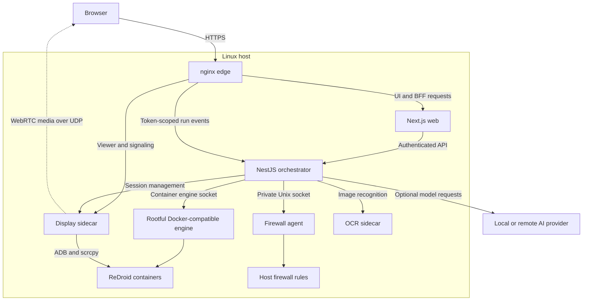

# Architecture overview

Rebroid runs Android applications and automations on a single Linux host. The web UI handles
user access, the orchestrator manages applications, and dedicated services handle display
streaming, host firewall rules, and OCR. There is no distributed control plane or shared database.

## System layout

The edge publishes HTTPS on port `3443` by default. WebRTC also publishes a UDP range.
Other service ports remain internal in the supplied [Compose deployment](../deploy/compose.yaml).
The firewall agent shares the host network namespace and exposes only a Unix socket.

## Service responsibilities

| Component                                           | Owns                                                                                                                          |
| --------------------------------------------------- | ----------------------------------------------------------------------------------------------------------------------------- |
| **Web** — Next.js                                   | Pages, authentication, users/groups, permissions, audit records, and the backend-for-frontend (BFF).                          |
| **Orchestrator** — NestJS                           | Stored application state, lifecycle jobs, APKs, Docker operations, workflows, schedules, settings, and feature configuration. |
| **Display sidecar** — NestJS and a Go WebRTC bridge | Viewer sessions, ADB, scrcpy sources, device controls, and media delivery.                                                    |
| **Firewall agent**                                  | Reconciliation of Rebroid-owned outbound firewall rules on the host.                                                          |
| **OCR sidecar** — FastAPI and PaddleOCR             | Image validation, preprocessing, model readiness, and bounded text recognition.                                               |
| **ReDroid containers**                              | Android execution and application data.                                                                                       |

## Application requests

1. The browser sends a same-origin request or Server Action to the web backend.
2. The web backend validates the session, permission, resource ownership, and input.
3. It calls the authenticated orchestrator API. Application services coordinate persistence
   and runtime operations through focused capability interfaces.
4. The web backend returns a public result with a request ID and a stable error code.

Normal application lists and details read stored state. Fresh Docker state is requested through
explicit reconciliation, rather than making every page read contact the engine.

Ordinary browser operations use the BFF. Automation event streams are a separate path: after web
authorization, the browser receives a short-lived subscription token and connects through the edge
straight to the orchestrator's event WebSocket. The edge strips internal shared-secret headers.

## Live display

The web backend authorizes access before a viewer session is created. The orchestrator prepares
the Android target; the display sidecar owns the session and its short-lived token.

Viewer assets, WebSocket media, and WebRTC signaling route from the edge to the sidecar.
WebRTC media travels directly between the sidecar and browser over UDP. Next.js does not relay media.

A session/profile source supervisor owns scrcpy. Each viewer transport attaches as an independent
consumer with a bounded queue. A disconnected browser or failed decoder detaches that consumer;
it does not tear down Android or ADB. See [display streaming](display-streaming.md) for the protocol
and recovery rules.

## Workflows and AI

The orchestrator stores workflow definitions, reserves a target before execution, runs steps,
and records ordered events. Conditional status updates prevent canceled or completed runs
from being overwritten by late work. Interrupted automation runs fail after restart.

AI tasks use a repeated observe, decide, validate, and act loop. Screenshots, Android UI evidence,
and optional OCR ground each decision. Provider transport and server flavor are configured
separately. AI shell access is denied by default; a permitted escalation grants allowlisted,
read-only commands for one follow-up run.

The [orchestrator guide](orchestrator-architecture.md) covers lifecycle and automation coordination.

## State and recovery

| State                                                        | Owner and storage                                    |
| ------------------------------------------------------------ | ---------------------------------------------------- |
| Users, authentication, preferences, and audit records        | Web SQLite database and files in `web-data`.         |
| Applications, lifecycle jobs, workflows, runs, and events    | Orchestrator SQLite database in `orchestrator-data`. |
| Runtime settings, provider configuration, and feature intent | Orchestrator settings file in `orchestrator-data`.   |
| Uploaded APKs                                                | `orchestrator-uploads`.                              |
| Android application data                                     | Managed runtime volumes.                             |
| Internal credentials and TLS material                        | Shared secret volume and web data volume.            |
| Viewer sessions and effective sidecar feature state          | Display-sidecar memory.                              |

Each process owns its database and files. SQLite is configured for local use; there is no multi-host
coordination layer. Application lifecycle recovery follows persisted job reservations. Automation
runs and interrupted image patch jobs fail instead of replaying partially completed work.

Pre-release schemas have no in-place upgrade path. Use the documented
[state reset procedures](operations.md#stored-state) when a schema changes.

## Feature configuration

The orchestrator persists feature intent and revision, then publishes an immutable runtime snapshot.
OCR, firewall, and image-builder checks stay local. Only the virtual-display subset is synchronized
to the display sidecar; absent, stale, or disabled state blocks new virtual surfaces.

Disabling a feature blocks new work according to its policy. In-flight OCR and image builds can
finish, existing virtual displays drain, and disabling the firewall feature does not remove
existing host rules. Feature flags do not replace authentication, permissions, or health checks.

## Code boundaries

Runtime integrations stay in `apps/*`. Framework-neutral behavior shared by at least two apps,
and generated API contracts, live in [`packages/*`](../packages/README.md).

The web app separates feature UI, shared browser/server contracts, and server-only services.
The orchestrator separates domain use cases from Docker, database, filesystem, and process adapters.
Cross-domain calls use explicit facades or capability contracts; dependency checks enforce these boundaries.

Continue with the [web contributor guide](web-contributor-guide.md),
[orchestrator architecture](orchestrator-architecture.md), or [contribution guide](../CONTRIBUTING.md).
