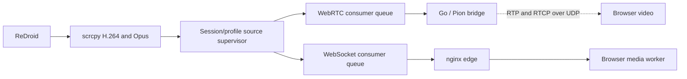

# Display streaming

The display sidecar relays ReDroid's scrcpy H.264 video and Opus audio without transcoding.
WebRTC is the primary transport. WebSocket playback uses WebCodecs/WebGL2 in Chromium and
fragmented MP4/MediaSource in Firefox.

## Media flow

The edge sends `/viewer/display` and `/rebroid/display` traffic directly to the sidecar.
WebRTC signaling uses HTTPS; RTP/RTCP uses the published UDP range. Next.js authorizes viewer
access but never relays media.

The sidecar owns in-memory sessions, expiry, and capacity. Internal session management requires
a shared secret; public viewer routes require a short-lived session token. A source supervisor
owns scrcpy for a session/profile. Browser, peer, decoder, or bridge failures detach only that
consumer. Sources can remain alive for 30 seconds without consumers; release, expiry, profile
changes, shutdown, or a genuine source failure close them.

## RBD1 protocol

Every internal media sink uses this big-endian envelope:

| Offset | Bytes | Field                                             |
| -----: | ----: | ------------------------------------------------- |
|      0 |     4 | ASCII magic `RBD1`.                               |
|      4 |     1 | Version `1`.                                      |
|      5 |     1 | Media kind: video `1`, audio `2`.                 |
|      6 |     2 | Configuration, keyframe, and discontinuity flags. |
|      8 |     4 | Unsigned sequence number.                         |
|     12 |     8 | Unsigned scrcpy timestamp in microseconds.        |
|     20 |     4 | Payload length.                                   |

Video payloads are complete H.264 Annex-B access units; codec configuration is a separate frame.
Audio payloads contain one Opus packet. TypeScript, Go, and browser consumers validate envelopes.

## Source and recovery invariants

- Preserve unsigned source timestamps and flags. Never replace source timing with a configured-FPS clock.
- Each consumer owns an independent bounded queue: video is capped at three frames or 75 ms;
  audio is capped at 100 ms. A slow consumer must not pause scrcpy or another consumer.
- Video overflow discards the queued group of pictures (GOP), suppresses delta frames, and resumes
  with cached codec configuration plus an IDR keyframe. Never drop an arbitrary delta and continue.
- Resynchronization discards audio older than the resumed keyframe. Reattachment caches are bounded
  to two seconds and 16 MiB.
- WebRTC waits for configuration and an IDR before answering, negotiates the exact compatible H.264
  profile, derives RTP timing from source timestamps, and continuously drains sender RTCP.
- Consumer attachment, PLI, and decoder recovery use scrcpy v4 reset-video message `17` over the
  existing control socket, coalesced to at most once per second. An explicit reset must yield
  configuration and an IDR within three seconds before its watchdog can restart the source attempt.
- Static screens are healthy. Recovery must compare advancing source frames with delivery and
  presentation, rather than treating an idle source as a freeze.
- Retries never silently lower requested resolution, FPS, bitrate, or switch transport.

WebSocket decoding stays in the media worker where browser support permits. Chromium keeps
encoded access units and decoded frames off the main thread. Firefox uses worker-produced fMP4
and main-thread MediaSource. Decoder/backlog recovery resynchronizes the consumer rather than
reconnecting its media socket. PCM is delivered to an AudioWorklet with a bounded ring.

All transports share validated device-control semantics. Discrete controls use reliable delivery;
WebRTC pointer movement uses an unordered channel and coalesces updates per animation frame.

## Protected scrcpy lifecycle

ADB commands, listener registration, video → audio → control socket acquisition, process launch,
retry, and cleanup are order-sensitive. Do not reorder or merge these operations for style or
file size. A transport closing must not destroy the source's ADB connection or scrcpy process.

Without a dedicated Redroid verification pass, refactoring is limited to pure SPS parsing,
compatibility-probe parsing, retry classification, and stream-option selection. Changes to
protected ordering require the manual matrix below, with before/after results in the pull request.

## Diagnostics

The viewer reports `ViewerStreamMetricsV4` once per second. Compare stages rather than relying
on one FPS value:

- Source, relay, bridge, RTP, receive, decode, and presentation rates and sequence watermarks.
- Requested/effective profile, actual encoder, H.264 profile, dimensions, source and wire bitrate.
- Frame gaps, jitter, decode time, live-edge age, queue depth, drops, freezes, RTT, and packet loss.
- PLI/NACK, resync/reset/restart counts, event-loop utilization, and GC pauses.

A freeze requires source progress with no presentation for over 100 ms. Static screens do not
increment it. The encoder bitrate target is an upper quality target, so lower wire bitrate on
static content is expected.

## Reverse proxies

Set the final browser host in `REBROID_PUBLIC_HOSTS`. A front proxy can use the edge's private
TLS SNI name `rebroid-web`; the HTTP Host still needs to match the public allowlist.

Media paths need HTTP/1.1 upgrades, `tcp_nodelay`, long read/send timeouts, and buffering,
request buffering, caching, and compression disabled. Enable WebSocket support in Nginx Proxy Manager.
Compare a direct-sidecar path with the Rebroid edge and any additional proxy before blaming the encoder.

## Manual verification

Use a native Linux rootful engine with binder support. Record host, engine, Android image,
scrcpy version, requested/effective profiles, relevant logs, and observed results.

| Area            | Required coverage                                                         |
| --------------- | ------------------------------------------------------------------------- |
| Android         | ReDroid 13 and 14; 15/16 must fail clearly as unsupported.                |
| Transport       | WebRTC and WebSocket; Chromium and Firefox.                               |
| Media           | Video with audio enabled and disabled.                                    |
| Controls        | Touch, keyboard, actions, clipboard, and ADB fallback.                    |
| Connections     | Direct and forward tunnels, fallback, repeated create/release.            |
| Recovery        | Disconnect, retry, reconnect, expiry, shutdown, and final cleanup.        |
| Virtual display | Rejection while disabled; creation/release after synchronized enablement. |

### Performance validation

The interactive profile is native resolution, 60 FPS, H.264, a 16 Mbps encoder target, and a
one-second IDR interval. Scrcpy is variable-frame-rate; measure sustained FPS only with a
deterministic motion workload, not a static screen.

Run ten minutes of active 1080×2340 motion over wired LAN. These are acceptance targets, not
performance claims: at least 57 presented FPS in 95% of one-second windows; presentation-gap
p95 ≤25 ms and p99 ≤50 ms with none over 100 ms; decode p95 ≤10 ms; decode-to-draw p95 ≤16.7 ms;
at most one pending presentation frame; A/V skew within 80 ms; input-to-photon p95 below 100 ms
for WebRTC and 120 ms for WebSocket; no scrcpy/ADB restarts during consumer recovery.

Repeat with ten minutes of static content, requiring no false freeze, reconnect, encoder reset,
or ADB reset. Test direct, edge, and additional proxy routes; repeat WebRTC at 50 ms RTT and 1%
packet loss. Use a synchronized visual trigger and high-frame-rate capture for input latency;
browser and Android clocks are not interchangeable.
