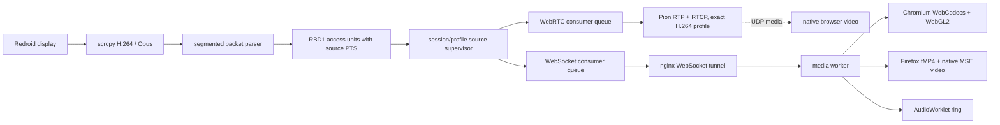

# Display streaming

Rebroid keeps scrcpy/Redroid as the H.264 and Opus encoder. The display
sidecar relays timestamped media without transcoding. WebRTC is the primary
transport. WebSocket uses worker-owned WebCodecs/WebGL2 in Chromium and
fragmented MP4/MediaSource in Firefox.

## Data flow and ownership

The source supervisor owns the scrcpy process and the protected video → audio
→ control socket sequence. A browser, WebSocket, decoder, bridge, or peer
failure detaches only that consumer. The source stays alive for 30 seconds
without consumers. Session release/expiry, an intentional profile change,
sidecar shutdown, a genuine scrcpy failure, or a failed explicit encoder-reset
watchdog closes it.

Consumer attachment, PLI, and decoder recovery send the rate-limited scrcpy v4
reset-video control message (`17`) over the existing control socket. They do
not reset ADB or reorder scrcpy socket setup. The reset must produce codec
configuration and an IDR within three seconds; only that explicit watchdog may
escalate the recovery to a source-attempt restart.

Nginx is the only published HTTPS service. It routes `/viewer/display` and
`/rebroid/display` directly to the private display sidecar, `/api/v1` to the
orchestrator, and remaining traffic to Next.js. WebRTC signaling crosses
nginx, but RTP/RTCP uses the sidecar UDP range directly. Neither transport
traverses the Next.js process.

## RBD1 frame envelope

All internal media sinks use one breaking, big-endian envelope:

| Offset | Size | Field                                         |
| -----: | ---: | --------------------------------------------- |
|      0 |    4 | ASCII magic `RBD1`                            |
|      4 |    1 | version, currently `1`                        |
|      5 |    1 | media kind: video `1`, audio `2`              |
|      6 |    2 | flags: configuration, keyframe, discontinuity |
|      8 |    4 | unsigned sequence number                      |
|     12 |    8 | unsigned scrcpy timestamp in microseconds     |
|     20 |    4 | payload byte length                           |

Each video payload is one complete H.264 Annex-B access unit. Codec
configuration remains a separate frame. Audio payloads contain one scrcpy Opus
packet. TypeScript, Go, and the browser worker reject malformed envelopes; no
legacy parser remains.

## Queue and recovery invariants

- Every consumer has an independent live-edge queue. One blocked consumer
  cannot pause the source socket or another consumer.
- Video is capped at three frames or 75 ms of queued PTS. Overflow discards the
  queued GOP, suppresses deltas, and resumes with cached configuration and the
  next IDR.
- Audio is capped at 100 ms. Video resynchronization discards audio older than
  the resumed keyframe.
- Source PTS remains authoritative. Dropped media creates a real timestamp gap;
  no fixed `1 / configured FPS` cadence is synthesized.
- Keyframe recovery is measured in advancing source PTS. A static screen does
  not time out merely because it emits no frames.
- Codec configuration and one complete GOP are cached for reattachment,
  bounded to two seconds and 16 MiB.
- Requested resolution, FPS, and bitrate are never silently reduced. Retry may
  disable audio or stream control, and diagnostics report the reason.

## Browser media planes

WebRTC remains on the native `<video>` presentation path. Before creating the
answer, the sidecar waits for cached SPS/PPS plus an IDR, derives the exact
`profile-level-id`, validates that the browser offered compatible H.264
packetization mode 1, and registers only that codec in Pion. Source PTS drives
RTP timestamps and sender reports. The viewer starts audio and video
`RTCRtpReceiver.jitterBufferTarget` at 20 ms, increases it in 10 ms steps after
late frames or repeated gaps, caps it at 40 ms, and decreases it after ten
stable seconds. Presentation is counted with `requestVideoFrameCallback`.
The SPS-declared level is reported against the requested pixel rate, but a
lower declared macroblock rate is diagnostic rather than fatal: scrcpy's
`max_fps` is a variable-frame-rate ceiling, not proof that every second carries
that many encoded frames.

A static source is healthy. Recovery begins only when source frames advance
while RTP, decode, and presentation remain unchanged for three consecutive
one-second samples. ICE `disconnected` gets a five-second grace period. Fresh
peers retry after 300 ms, 750 ms, and 1.5 seconds, then surface a blocking
WebRTC diagnostic. The viewer never changes the requested transport
automatically.

One WebSocket media worker owns the media WebSocket, RBD1 parsing, sequence
validation, audio decode, reconnect generation, and heartbeat. In Chromium it
also owns `VideoDecoder` and an OffscreenCanvas WebGL2 renderer. Encoded access
units and decoded `VideoFrame` objects do not cross the main thread. Normal
access units are passed directly to WebCodecs; only configuration is
NAL-parsed. At most one decoded frame waits for the next worker animation
frame, and a newer frame replaces and closes the older one. The worker starts
hardware-preferred and can reconfigure software-preferred after repeated
decoder backlog without reconnecting. Decode backlog resets only the decoder
and asks the source for a new IDR.

In Firefox the worker converts complete Annex-B access units to AVC samples
and emits a fresh fMP4 initialization segment plus media fragments containing
at most two frames or 33 ms. The main thread owns MediaSource and a native
`<video>` because Firefox worker MSE support is insufficient. Adjacent fMP4
fragments are combined into one append, with a 75 ms operating target and a
500 ms/16 MiB hard bound. Queue cost is pending frame work rather than source
PTS duration, so a legitimate variable-frame-rate gap is not mistaken for
backlog. Old buffered data is pruned after 500 ms, and buffered lead follows
the same adaptive 20–40 ms target. Overflow, a discontinuity, or a missing IDR
requests local source resynchronization rather than reconnecting the socket.
The last presented frame remains visible while MediaSource is replaced. Three
genuine MSE recovery failures switch the consumer locally to WebCodecs/WebGL2
without replacing the media socket.

Decoded PCM moves directly to an AudioWorklet over a transferred message port.
The ring targets 30 ms, has a 60 ms hard cap, drops oldest audio on overflow,
emits silence on underflow, and rebases on discontinuity. WebSocket playback
requires Worker, AudioWorklet, and either Chromium WebCodecs/OffscreenCanvas or
Firefox MediaSource support.

WebRTC uses an ordered reliable data channel for taps, keys, clipboard, and
discrete actions. Pointer movement uses an unordered `maxRetransmits: 0`
channel and is coalesced to one update per browser animation frame.

## ViewerStreamMetricsV4

The iframe reports `rebroid-viewer-stream-metrics-v4` with `version: 4` once
per second. Metrics are stage-specific instead of hiding bursty delivery behind
one FPS value:

- source, relay-ingress, bridge-input, RTP-sent, received, decoded, drawn, and
  actually-presented FPS;
- highest received, decoded, and presented RBD1 sequence watermarks;
- encoder target in the effective profile, source bitrate, and wire bitrate;
- active-source frame-gap p50/p95/p99/max;
- source inter-frame p95, network inter-arrival jitter p95, decode p95,
  decode-to-draw p95, and live-edge age p95;
- RTP packetization/write p95, Firefox MSE buffered lead, WebCodecs decode
  depth, relay, pending-render, AudioWorklet, and WebRTC jitter-buffer depth;
- relay, decode, presentation, and audio drops;
- reconnect, resync, video-reset, source-restart, PLI, NACK, packet-loss, RTT,
  and main-thread long-task counters;
- relay p95/p99, event-loop utilization, GC-pause p95, renderer, actual encoder,
  SPS profile/level, negotiated SDP profile, dimensions, pixel rate, effective
  profile, source attempt, and consumer generation.

A freeze is counted only when the source advanced but no frame was presented
for more than 100 ms. Static screens do not increment freeze counters. “Encoder
target” is an upper quality/bitrate target; “wire bitrate” is current encoded
traffic and is naturally lower on static content.

## Edge and double reverse proxies

The Rebroid edge accepts the private TLS SNI name `rebroid-web` so a master
Nginx/Nginx Proxy Manager can forward HTTPS to `rebroid-web:3443`. Public HTTP
Host values still must appear in `REBROID_PUBLIC_HOSTS`. Both proxy layers must
use HTTP/1.1 upgrades, disable buffering, request buffering, caching, and
compression on media paths, enable `tcp_nodelay`, and use long read/send
timeouts. Keep WebSocket support enabled in Nginx Proxy Manager.

Compare direct-sidecar, Rebroid-edge, and VPS-master routes. If the master still
adds more than 5 ms p95 inter-arrival jitter after tuning, use a separately
allowlisted direct media hostname or L4 route while retaining session-token and
origin validation.

## Acceptance and escalation

For ten minutes of deterministic active native 1080×2340 motion in current
Chromium and Firefox over wired LAN:

- at least 57 presented FPS in 95% of one-second windows;
- presentation-gap p95 at most 25 ms, p99 at most 50 ms, and no gap above 100 ms;
- decode p95 at most 10 ms and decode-to-draw p95 at most 16.7 ms;
- at most one pending presentation frame;
- input-to-photon p95 below 100 ms for WebRTC and 120 ms for WebSocket;
- A/V skew within 80 ms;
- zero scrcpy/ADB restarts during consumer recovery.

The ten-minute static test must produce no false freeze, reconnect, encoder
reset, or ADB reset. Repeat at 50 ms RTT and 1% loss, and verify direct, edge,
and VPS routes separately. Measure input-to-photon with a synchronized visual
trigger and high-frame-rate capture; browser and Android clocks are not
interchangeable.

Keep the Node relay while it stays below 1 ms p95 and 3 ms p99, below 50%
event-loop utilization, and below 10 ms GC-pause p95. Build the persistent Go
media gateway only if an acceptance test still fails while scrcpy supplies at
least 57 FPS and Node crosses one of those gates.

The interactive default is native resolution (`max_size=0`), 60 FPS, 16 Mbps
encoder target, H.264, no intentional frame reordering, and a fixed one-second
IDR interval. Scrcpy is variable-frame-rate, so the 57 FPS requirement applies
only while the deterministic motion workload continuously changes the source.
Failure to sustain the native profile is reported and never hidden by a
resolution, frame-rate, or transport downgrade.

Complete the protected manual matrix in
[operations.md](operations.md#manual-scrcpy-harness) for Redroid 13/14, direct
and forward tunnels, video/audio/control, reconnect/cleanup, and virtual
displays.
