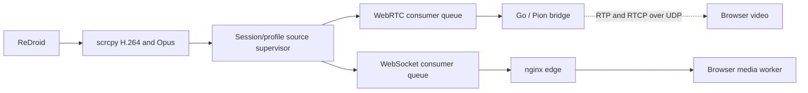

# Display streaming

The display sidecar relays ReDroid's scrcpy H.264 video and Opus audio without transcoding.
WebRTC is the primary transport. WebSocket playback uses WebCodecs/WebGL2 in Chromium and
fragmented MP4/MediaSource in Firefox.

## Media flow

The edge sends `/viewer/display` and `/rebroid/display` traffic directly to the sidecar.
WebRTC signaling uses HTTPS; RTP/RTCP uses the published UDP range. Next.js authorizes viewer
access but never relays media.

The sidecar owns in-memory sessions, expiry, and capacity. A WebRTC offer owns its consumer
attempt through target preparation, bootstrap, signaling, and detach. Release or replacement
cancels that attempt. Internal session management requires a shared secret. Viewer URLs contain a
session ID. The sidecar uses the same-origin browser session to verify the signed-in owner, active
container, and capabilities with web before starting WebSocket media, WebRTC, or viewer controls.
Active transports recheck access every 10 seconds and close on denial or authorization failure.
Revocation commands close affected transports as soon as the sidecar receives them. Audio and
Android-to-browser clipboard delivery follow the session's capabilities. A source supervisor
owns scrcpy for a session/profile. Browser, peer, decoder, or bridge failures detach only that
consumer. Sources can remain alive for 30 seconds without consumers; release, expiry, profile
changes, shutdown, or a genuine source failure close them.
Transport recovery reuses the current session. If the sidecar reports that the session is gone,
both transports ask the parent viewer to refresh through the authorized web path. An automatic
refresh is attempted once until a replacement displays video. Initial startup retries in both
viewer entry points are bounded by the Android startup deadline.

## RBD1 protocol

Every internal media sink uses this big-endian envelope:

| Offset | Bytes | Field                                             |
| -----: | ----: | ------------------------------------------------- |
|      0 |     4 | ASCII magic `RBD1`.                               |
|      4 |     1 | Version `1`.                                      |
|      5 |     1 | Media kind: video `1`, audio `2`.                 |
|      6 |     2 | Configuration, keyframe, and discontinuity flags. |
|      8 |     4 | Unsigned sequence number.                         |
|     12 |     8 | Unsigned scrcpy timestamp in microseconds.        |
|     20 |     4 | Payload length.                                   |

Video payloads are complete H.264 Annex-B access units; codec configuration is a separate frame.
Audio payloads contain one Opus packet. TypeScript, Go, and browser consumers validate envelopes.
The TypeScript encoder and Go decoder verify the same binary fixture, including unsigned
timestamps and configuration, keyframe, and discontinuity flags.

## Source and recovery invariants

- Preserve unsigned source timestamps and flags. Never replace source timing with a configured-FPS clock.
- Each consumer owns an independent bounded queue: video is capped at three frames or 75 ms;
  audio is capped at 100 ms. A slow consumer must not pause scrcpy or another consumer.
- Video overflow discards the queued group of pictures (GOP), suppresses delta frames, and resumes
  with cached codec configuration plus an IDR keyframe. Never drop an arbitrary delta and continue.
- Resynchronization discards audio older than the resumed keyframe. Reattachment caches are bounded
  to two seconds and 16 MiB. Replay a cached GOP only if it fits the consumer's live-edge queue.
- WebRTC negotiates from a configuration and IDR from the same source generation. If the source
  changes generation during signaling, the offer fails with a retryable response. Media attaches
  after the peer connects and checks that generation again before sending the first frame.
  A later configuration change detaches only the negotiated consumer. The bridge derives RTP
  timing from source timestamps and continuously drains sender RTCP.
- The Go bridge owns shutdown of its peer and media workers. A track-local audio error closes
  that input and leaves video active. A shared timestamp regression ends the peer attempt.
- Repeated RTCP feedback leaves an outstanding consumer recovery deadline in place. The deadline
  advances with source PTS while waiting for configuration and an IDR.
- Consumer attachment, PLI, and decoder recovery use scrcpy v4 reset-video message `17` over the
  existing control socket, coalesced to at most once per second. An outstanding reset keeps its
  original three-second deadline after the control write completes. A configuration followed by an
  IDR completes recovery. Losing the control socket cancels its watchdog.
- Static screens are healthy. Recovery must compare advancing source frames with delivery and
  presentation, rather than treating an idle source as a freeze.
- Retries never silently lower requested resolution, FPS, bitrate, or switch transport.

WebSocket decoding stays in the media worker where browser support permits. Chromium keeps
encoded access units and decoded frames off the main thread. Firefox uses worker-produced fMP4
and main-thread MediaSource. Decoder/backlog recovery resynchronizes the consumer rather than
reconnecting its media socket. Both renderer paths wait for configuration and an IDR after recovery.
MediaSource fragments and presentation callbacks carry a recovery epoch so the browser can discard
work from an abandoned append queue. PCM is delivered to an AudioWorklet with a bounded ring.

All transports share validated device-control semantics. Parent-window keyboard capture follows the
active surface. Discrete controls use reliable delivery and report correlated dispatch outcomes.
Commands waiting for a reconnect are acknowledged after the transport write completes. They fail if
the queue is full, the session ends, or three seconds elapse before dispatch, including time spent
waiting for a Direct ADB acknowledgment of the preceding write. If a submitted write fails or
its completion misses the deadline, the outcome is unknown. Live pointer phases are never queued for replay after a reconnect. The browser
and Direct ADB queues reserve room for a pointer release. Virtual surfaces require stream control
because the ADB fallback targets the device's default display.
The browser chooses a fallback before sending a command. A missing acknowledgment leaves the
outcome unknown. WebRTC pointer movement uses an unordered channel and coalesces updates per animation frame.
The Go relay sends correlated replies in order and coalesces replaceable telemetry under pressure.

## Browser hardware decoding

Decoding occurs on the viewer machine. The WebSocket WebCodecs path initially requests
`hardwareAcceleration: "prefer-hardware"` and switches to a software preference after a decoder
queue overflow. This [WebCodecs preference](https://www.w3.org/TR/webcodecs/#hardware-acceleration)
may be ignored by the browser. The reported `decoderPreference` describes the requested
policy, not proof of hardware use. WebRTC and Firefox MediaSource decoding are selected
by the browser's native media stack.

Scrcpy 5's `--hwdec` setting belongs to its native desktop player. Rebroid's sidecar ships
the Android server and forwards compressed packets without a desktop player or video
decoder. GPU access in the sidecar therefore does not change browser decoding. See the
[Linux Docker requirements](deployment.md#gpu-acceleration-and-scrcpy-5) for the distinction
between Android rendering/encoding, the relay, and client playback.

## Protected scrcpy lifecycle

ADB commands, listener registration, video → audio → control socket acquisition, process launch,
retry, and cleanup are order-sensitive. Do not reorder or merge these operations for style or
file size. A transport closing must not destroy the source's ADB connection or scrcpy process.
The forward video socket holds bytes after the dummy handshake until the parser takes ownership.
The reverse listener stops accepting connections without waiting for the handed-off sockets.
Attempt cleanup waits for the listener to drain after destroying those sockets.

Without a dedicated Redroid verification pass, refactoring is limited to pure SPS parsing,
compatibility-probe parsing, retry classification, and stream-option selection. Changes to
protected ordering require the manual matrix below, with before/after results in the pull request.

## Diagnostics

The image pins [scrcpy 5.0.1](https://github.com/Genymobile/scrcpy/releases/tag/v5.0.1)
and verifies the release archive checksum. `SCRCPY_VERSION` must match the server artifact
when overriding the image defaults. The adapter name `scrcpy-server-v4-rbd1` identifies the
compatible wire format, not the bundled release; `scrcpyVersion` reports the release.
Android 13–16 are admitted. Android 16 video/control has been reported working; Android 15
and Android 16 audio still need the manual matrix below. Android 17 remains gated.

### Audio failures

Enabling audio requests Opus capture using scrcpy's default `output` source (remote submix).
The viewer toggle does not establish that Android capture or browser playback succeeded.
The sidecar preserves the audio failure reason in its `audio-disabled` status; both viewer
transports display it. A missing audio connection, Android's disabled-stream marker, and
an invalid/configuration-failed audio stream are different failures. Android `AudioRecord`,
`AudioFlinger`, `AudioPolicy`, and Opus messages are retained by the compatibility log filter.

An unrelated initial ADB/video/control failure must not disable requested audio. Confirmed
source audio failures remain cached for the session. Opening an explicit video-only source
or releasing the session clears that cache. Browser audio-decoder failures disable only
that consumer's audio playback and report once per connection; video remains connected.

For diagnosis, retain the exact viewer message, transport/browser, effective scrcpy version,
Android image, and administrator-side logs. A scrcpy codec marker alone cannot distinguish
an Android audio-policy failure from a missing encoder. Upstream documents the capture and
encoder requirements in its [audio guide](https://github.com/Genymobile/scrcpy/blob/v5.0.1/doc/audio.md).
Its direct audio-capture implementation is unchanged from 4.0 to 5.0.1, so upgrading alone
is not evidence that a device capture failure is resolved. The audio fixes here have automated
coverage; audible playback still requires the manual verification below.

### Stream metrics

The viewer reports `ViewerStreamMetricsV4` once per second. Compare stages rather than relying
on one FPS value:

- Source, relay, bridge, RTP, receive, decode, and presentation rates and sequence watermarks.
- Requested/effective profile, actual encoder, H.264 profile, dimensions, source and wire bitrate.
- Frame gaps, jitter, decode time, live-edge age, queue depth, drops, freezes, RTT, and packet loss.
- PLI/NACK, resync/reset/restart counts, event-loop utilization, and GC pauses.

WebRTC reports presentation gaps separately from freezes. It records a freeze after consecutive
samples show advancing input and no new presented frames. When a browser has no presentation
counter, decoded-frame progress can still distinguish an upstream stall from an idle source.
The encoder bitrate target is an upper quality target, so lower wire bitrate on static content
is expected.

## Reverse proxies

Set the final browser host in `REBROID_PUBLIC_HOSTS`. A front proxy can use the edge's private
TLS SNI name `rebroid-web`; the HTTP Host still needs to match the public allowlist.

Media paths need HTTP/1.1 upgrades, `tcp_nodelay`, long read/send timeouts, and buffering,
request buffering, caching, and compression disabled. Enable WebSocket support in Nginx Proxy Manager.
Compare a direct-sidecar path with the Rebroid edge and any additional proxy before blaming the encoder.

## Manual verification

Use a native Linux rootful engine with binder support. Record host, engine, Android image,
scrcpy version, requested/effective profiles, relevant logs, and observed results.

| Area            | Required coverage                                                         |
| --------------- | ------------------------------------------------------------------------- |
| Android         | ReDroid 13, 14, 15, and 16; 17+ must fail clearly as unsupported.         |
| Transport       | WebRTC and WebSocket; Chromium and Firefox.                               |
| Media           | Video with audio enabled/disabled; audible app output, toggle/reopen, and explicit failure reasons. |
| Controls        | Touch, keyboard, actions, clipboard, and ADB fallback.                    |
| Connections     | Direct, forward, and reverse tunnels, fallback, repeated create/release.   |
| Recovery        | Disconnect, retry, reconnect, expiry, shutdown, and final cleanup.        |
| Virtual display | Rejection while disabled; creation/release after synchronized enablement. |

### Performance validation

The interactive profile is native resolution, 60 FPS, H.264, a 16 Mbps encoder target, and a
one-second IDR interval. Scrcpy is variable-frame-rate; measure sustained FPS only with a
deterministic motion workload, not a static screen.

Run ten minutes of active 1080×2340 motion over wired LAN. These are acceptance targets, not
performance claims: at least 57 presented FPS in 95% of one-second windows; presentation-gap
p95 ≤25 ms and p99 ≤50 ms with none over 100 ms; decode p95 ≤10 ms; decode-to-draw p95 ≤16.7 ms;
at most one pending presentation frame; A/V skew within 80 ms; input-to-photon p95 below 100 ms
for WebRTC and 120 ms for WebSocket; no scrcpy/ADB restarts during consumer recovery.

Repeat with ten minutes of static content, requiring no false freeze, reconnect, encoder reset,
or ADB reset. Test direct, edge, and additional proxy routes; repeat WebRTC at 50 ms RTT and 1%
packet loss. Use a synchronized visual trigger and high-frame-rate capture for input latency;
browser and Android clocks are not interchangeable.
