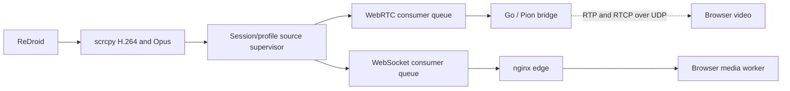

# Display streaming

The display sidecar relays ReDroid's scrcpy H.264 video and Opus audio without transcoding.
WebRTC is the primary transport. WebSocket playback uses WebCodecs/WebGL2 in Chromium and
fragmented MP4/MediaSource in Firefox.

## Media flow

The edge sends `/viewer/display` and `/rebroid/display` traffic directly to the sidecar.
WebRTC signaling uses HTTPS. Direct media for every viewer shares the display sidecar’s published UDP port. Next.js authorizes viewer
access but never relays media.

The sidecar owns in-memory sessions, expiry, and capacity. Each browser viewer has its own
WebRTC attempt within its authorized account session and display session. Retrying replaces only
that viewer's attempt. Ending a display session closes all of its attempts. The sidecar rejects
new WebRTC viewers before capture when its peer budget is full. Internal session management
requires a shared secret. Viewer URLs contain a
session ID. The sidecar uses the same-origin browser session to verify the signed-in owner, active
container, and capabilities with web before starting WebSocket media, WebRTC, or viewer controls.
Active transports recheck access every 10 seconds and close on denial or authorization failure.
Revocation commands close affected transports as soon as the sidecar receives them. Audio and
Android-to-browser clipboard delivery follow the session's capabilities. A source supervisor
owns scrcpy for a session/profile. Matching viewers share the capture. A different profile can
replace it once its viewers disconnect. Browser, peer, decoder, or bridge failures detach only
that consumer. Sources can remain alive for 30 seconds without consumers. Release, expiry,
shutdown, or a genuine source failure close them.
Transport recovery reuses the current session. If the sidecar reports that the session is gone,
both transports ask the parent viewer to refresh through the authorized web path. An automatic
refresh is attempted once until a replacement displays video. Both viewer entry points use the
current runtime's Ready timestamp for the startup retry window when that timestamp is available.

After transport recovery stops, the web viewer keeps a **Retry display** action visible over the
failed surface. It refreshes the viewer grant through the existing authorized web path, then
replaces that surface's browser consumer even when the session ID is unchanged. It does not
reload the page or request an Android, ADB, or scrcpy restart. Duplicate clicks are blocked while
refreshing; a refresh that does not complete within 30 seconds leaves the failure visible and
allows another attempt. A denied or unavailable embedded session refresh uses the existing
viewer error state. Successful presentation clears the failure; transient audio/status updates
do not dismiss it.

## RBD1 protocol

Every internal media sink uses this big-endian envelope:

| Offset | Bytes | Field                                             |
| -----: | ----: | ------------------------------------------------- |
|      0 |     4 | ASCII magic `RBD1`.                               |
|      4 |     1 | Version `1`.                                      |
|      5 |     1 | Media kind: video `1`, audio `2`.                 |
|      6 |     2 | Configuration, keyframe, and discontinuity flags. |
|      8 |     4 | Unsigned sequence number.                         |
|     12 |     8 | Unsigned scrcpy timestamp in microseconds.        |
|     20 |     4 | Payload length.                                   |

Video payloads are complete H.264 Annex-B access units; codec configuration is a separate frame.
Audio payloads contain one Opus packet. TypeScript, Go, and browser consumers validate envelopes.
The TypeScript encoder and Go decoder verify the same binary fixture, including unsigned
timestamps and configuration, keyframe, and discontinuity flags.

## Source and recovery invariants

- Preserve unsigned source timestamps and flags. Never replace source timing with a configured-FPS clock.
- Each consumer owns an independent bounded queue: video is capped at three frames or 75 ms;
  audio is capped at 100 ms. A slow consumer must not pause scrcpy or another consumer.
- Video overflow discards the queued group of pictures (GOP), suppresses delta frames, and resumes
  with cached codec configuration plus an IDR keyframe. Never drop an arbitrary delta and continue.
- Resynchronization discards audio older than the resumed keyframe. Reattachment caches are bounded
  to two seconds and 16 MiB. Replay a cached GOP only if it fits the consumer's live-edge queue.
- WebRTC negotiates from a configuration and IDR from the same source generation. If the source
  changes generation during signaling, the offer fails with a retryable response. Media attaches
  after the peer connects and checks that generation again before sending the first frame.
  A later configuration change detaches only the negotiated consumer. The retiring peer
  signals the format change on its reliable channel before closing. The viewer keeps the
  last picture during recovery and also watches for channel closure if the notice is lost.
  The bridge derives RTP timing from source timestamps and continuously drains sender RTCP.
- The Go bridge owns shutdown of its peer and media workers. A track-local audio error closes
  that input and leaves video active. A shared timestamp regression ends the peer attempt.
- Repeated RTCP feedback leaves an outstanding consumer recovery deadline in place. The deadline
  advances with source PTS while waiting for configuration and an IDR.
- A new capture must deliver configuration and an IDR before the sidecar can send scrcpy reset-video
  message `17` over its control socket. A bootstrap attachment can reuse the current
  configuration and IDR. A media attachment requests a reset only if the source cannot
  replay the current GOP within the consumer's queue limits. Attachment, PLI, and decoder
  recovery requests are coalesced to at most once per second. An outstanding reset keeps its original three-second
  deadline after the control write completes. A configuration followed by an IDR completes recovery.
  Losing the control socket cancels its watchdog.
- Static screens are healthy. Recovery must compare advancing source frames with delivery and
  presentation, rather than treating an idle source as a freeze.
- Retries never silently lower requested resolution, FPS, bitrate, or switch transport.

WebSocket decoding stays in the media worker where browser support permits. Chromium keeps
encoded access units and decoded frames off the main thread. Firefox uses worker-produced fMP4
and main-thread MediaSource. Decoder/backlog recovery first resynchronizes the consumer at
the live edge. Both renderer paths wait for configuration and an IDR after recovery.

After the first rendered frame, a worker watchdog checks receipt, decoding, and presentation
once a second. Four seconds without video receipt while fresh relay metrics report ongoing
source frames reconnects only that media consumer. A decode or presentation stall gets one
local resync, then a consumer reconnect if presentation has not resumed within four more
seconds. Configuration updates do not extend that recovery deadline. Idle sources, relay
metrics older than 2.5 seconds, and hidden tabs do not trigger this watchdog. A source restart,
consumer replacement, or visibility change starts a fresh observation window. Existing
session-expiry handling still routes recovery through the authorized web viewer.

The main display suspends its browser consumer when the document is hidden. WebRTC cancels
its offer and retries and closes its peer. WebSocket closes its media socket and keeps the
worker's canvas available for resume. Control connections and media processing suspend with
the viewer. A visible return starts one new attempt, including after a back/forward-cache
restore. A route exit closes that browser consumer. The display session can still be reused
subject to authorization and expiry.

If the last consumer detaches, scrcpy stays warm for the existing 30-second idle grace period.
Virtual display captures keep their existing visibility behavior because their Android display
is tied to capture lifetime. Main-display suspension does not extend Android's inactivity timer.

On desktop, **Minimize player** moves the main display into a floating player that stays open
across signed-in pages. Press **I** in the viewer when keyboard capture is off. Drag the compact
display or the handle to snap it smoothly to a window edge with a 24 px inset. Motion respects
the reduced-motion preference. The compact header appears on hover or keyboard focus in a row above
the display. Click the compact display to expand it, or drag it to change its dock. The player
keeps the display aspect ratio and follows that edge when the window resizes. Compact mode mutes playback and blocks input.
Expanded mode offers a vertical viewer toolbar on the inward side of the dock and clipboard
according to the account's permissions. The expanded top bar sits above the video and contains
**Collapse mini-player**. Drag from the outer resize corner to resize while preserving aspect
ratio and viewport bounds. Keyboard users can focus the resize corner and use the arrow keys.
Viewport changes and Android rotation refit the display and its inward-facing toolbar together,
preserving aspect ratio and the 24 px edge inset. Long toolbars
scroll within the display height. A player opened on desktop stays mounted if the window is
subsequently narrowed; opening a new mini-player still requires the desktop breakpoint.
Minimizing, expanding, and restoring keep the same iframe and media connection. The player uses
the main display's foreground suspension and scrcpy grace period.

MediaSource fragments and presentation callbacks carry a recovery epoch so the browser can discard
work from an abandoned append queue. PCM is delivered to an AudioWorklet with a bounded ring.

All transports share validated device-control semantics. Parent-window keyboard capture follows the
active surface. Discrete controls use reliable delivery and report correlated dispatch outcomes.
Commands waiting for a reconnect are acknowledged after the transport write completes. They fail if
the queue is full, the session ends, or three seconds elapse before dispatch, including time spent
waiting for a Direct ADB acknowledgment of the preceding write. If a submitted write fails or
its completion misses the deadline, the outcome is unknown. Live pointer phases are never queued for replay after a reconnect. The browser
and Direct ADB queues reserve room for a pointer release. Virtual surfaces require stream control
because the ADB fallback targets the device's default display.
The browser chooses a fallback before sending a command. A missing acknowledgment leaves the
outcome unknown. WebRTC pointer movement uses an unordered channel and coalesces updates per animation frame.
The Go relay sends correlated replies in order and coalesces replaceable telemetry under pressure.

## Browser hardware decoding

Decoding occurs on the viewer machine. The WebSocket WebCodecs path initially requests
`hardwareAcceleration: "prefer-hardware"` and switches to a software preference after a decoder
queue overflow. This [WebCodecs preference](https://www.w3.org/TR/webcodecs/#hardware-acceleration)
may be ignored by the browser. The reported `decoderPreference` describes the requested
policy, not proof of hardware use. WebRTC and Firefox MediaSource decoding are selected
by the browser's native media stack.

Scrcpy 5's `--hwdec` setting belongs to its native desktop player. Rebroid's sidecar ships
the Android server and forwards compressed packets without a desktop player or video
decoder. GPU access in the sidecar therefore does not change browser decoding. See the
[Linux Docker requirements](deployment.md#gpu-acceleration-and-scrcpy-5) for the distinction
between Android rendering/encoding, the relay, and client playback.

## Protected scrcpy lifecycle

ADB commands, listener registration, video → audio → control socket acquisition, process launch,
retry, and cleanup are order-sensitive. Do not reorder or merge these operations for style or
file size. A transport closing must not destroy the source's ADB connection or scrcpy process.
The forward video socket holds bytes after the dummy handshake until the parser takes ownership.
The reverse listener stops accepting connections without waiting for the handed-off sockets.
Attempt cleanup waits for the listener to drain after destroying those sockets.

Without a dedicated Redroid verification pass, refactoring is limited to pure SPS parsing,
compatibility-probe parsing, retry classification, and stream-option selection. Changes to
protected ordering require the manual matrix below, with before/after results in the pull request.

## Diagnostics

The image pins [scrcpy 5.0.1](https://github.com/Genymobile/scrcpy/releases/tag/v5.0.1)
and verifies the release archive checksum. `SCRCPY_VERSION` must match the server artifact
when overriding the image defaults. The adapter name `scrcpy-server-v4-rbd1` identifies the
compatible wire format, not the bundled release; `scrcpyVersion` reports the release.
Android 13–16 are admitted. Android 16 video/control has been reported working; Android 15
and Android 16 audio still need the manual matrix below. Android 17 remains gated.
Each scrcpy source checks Android compatibility once at admission. WebRTC offers
reuse that result before waiting for codec configuration, and startup failures can
still collect fresh diagnostics.

### Audio failures

Enabling audio requests Opus capture using scrcpy's default `output` source (remote submix).
The viewer toggle does not establish that Android capture or browser playback succeeded.
The sidecar preserves the audio failure reason in its `audio-disabled` status; both viewer
transports display it. A missing audio connection, Android's disabled-stream marker, and
an invalid/configuration-failed audio stream are different failures. Android `AudioRecord`,
`AudioFlinger`, `AudioPolicy`, and Opus messages are retained by the compatibility log filter.

An unrelated initial ADB/video/control failure must not disable requested audio. Confirmed
source audio failures remain cached for the session. Opening an explicit video-only source
or releasing the session clears that cache. Browser audio-decoder failures disable only
that consumer's audio playback and report once per connection; video remains connected.

For diagnosis, retain the exact viewer message, transport/browser, effective scrcpy version,
Android image, and administrator-side logs. A scrcpy codec marker alone cannot distinguish
an Android audio-policy failure from a missing encoder. Upstream documents the capture and
encoder requirements in its [audio guide](https://github.com/Genymobile/scrcpy/blob/v5.0.1/doc/audio.md).
Its direct audio-capture implementation is unchanged from 4.0 to 5.0.1, so upgrading alone
is not evidence that a device capture failure is resolved. The audio fixes here have automated
coverage; audible playback still requires the manual verification below.

### Startup timings

The app Diagnostics tab shows startup milestones from its existing orchestrator log,
scoped to the current provisioning/start attempt and runtime container. Elapsed times
start at container creation, or the start request when reusing a container. Concurrent
boot and network attachment are displayed by timestamp; their durations are not added.

The main display's first presented-frame event supplies the final milestone for both
WebRTC and WebSocket. It is recorded once per runtime startup in this tab's session
storage (at most 24 records), survives reloads, and is not overwritten by reconnects.
The total includes time spent waiting to open the viewer and uses server/browser wall
clocks. The panel also shows two browser intervals for the first successful display
session in that startup: requesting the session through sending the WebRTC offer
or opening the WebSocket, and that stream request through the first frame. These
intervals use monotonic browser timestamps. Missing milestones remain unavailable.
Only users authorized to view application logs see the section. It shares the existing
orchestrator-log query and follows lifecycle changes without an additional polling timer
or Docker/ADB reads; Refresh timings also refreshes that shared log data.

### Stream metrics

The viewer reports `ViewerStreamMetricsV4` once per second. Compare stages rather than relying
on one FPS value:

- Source, relay, bridge, RTP, receive, decode, and presentation rates and sequence watermarks.
- Requested/effective profile, actual encoder, H.264 profile, dimensions, source and wire bitrate.
- Frame gaps, jitter, decode time, live-edge age, queue depth, drops, freezes, RTT, and packet loss.
- PLI/NACK, resync/reset/restart counts, event-loop utilization, and GC pauses.

WebRTC reports presentation gaps separately from freezes. It records a freeze after consecutive
samples show advancing input and no new presented frames. When a browser has no presentation
counter, decoded-frame progress can still distinguish an upstream stall from an idle source.
The encoder bitrate target is an upper quality target, so lower wire bitrate on static content
is expected. In the live viewer, bitrate edits apply after a short pause so a series of slider
or number input changes only reconfigures the stream once.

**Streaming settings** retains the latest observed stream issue for the current app viewer. It
shows the transport, stage, observed time, WebSocket close code when available, and the WebRTC
attempt ID after a successful signaling response. Match the attempt ID with the sidecar logs
when the browser observes a channel closure without a more specific reason.

For repeated WebRTC recovery, the streaming diagnostics expose cumulative received,
decoded and presented frame counts and browser receiver loss/NACK/PLI counters
separately from bridge counters. They reuse the existing once-per-second sampler.
Use the consumer attempt ID to find the sidecar's attempt termination and the Go bridge's
peer termination. Each records the first reason observed at that layer. The source attempt ID,
codec generation, reset generation and reset completion elapsed time correlate
browser observations with source recovery. Reset generations count requests, not
codec changes. New source attempts clear prior reset evidence, and stale completion
messages cannot complete the current reset in the diagnostic view.

Capture these fields alongside a motion/idle/rotation reproduction on each transport.
A **First frame at new size** observation records the previous and presented dimensions.
The WebSocket interval starts when the worker receives the changed H.264 configuration.
WebCodecs measures through the canvas draw. WebRTC and MediaSource measure through a video frame callback.
The WebRTC interval starts when the browser sees the format-change notice or begins
recovery if the notice is unavailable. Measure rotation command to browser presentation
separately when comparing the complete interaction on a host.
A successful bridge write does not establish browser presentation. Repeated PLI
alone does not distinguish loss from decoder failure, and a closed reliable control
channel does not establish why the browser disconnected. Diagnostic additions do
not change deadlines, startup order or source ownership.

### Idle WebRTC picture-loss feedback

An unchanged Android screen can stop emitting frames after a short repeat burst.
[Scrcpy v4 requests a 100 ms repeat delay](https://github.com/Genymobile/scrcpy/blob/v4.0/server/src/main/java/com/genymobile/scrcpy/video/SurfaceEncoder.java),
while [libwebrtc can request a keyframe when decoding times out on a recently active stream](https://webrtc.googlesource.com/src/+/refs/heads/main/video/video_receive_stream2.cc).
Treating every PLI as encoder failure creates a loop: reset, repeat burst, idle timeout, reset.
The local Chromium/Go bridge replay reproduced requests at 4.15, 8.43 and 12.62 seconds
with all 44 frames decoded and zero packet loss or NACKs. This establishes a possible
cause of the matching production cadence; PLI alone is not proof of packet loss.
With the acknowledgement gate enabled, the same 16-second replay decoded all 11
initial frames, ignored one idle PLI and made zero reset requests. A separate replay
resumed H.264 delta frames after nine seconds of silence: all 22 frames decoded,
with zero reset requests. These are local browser/bridge results, not host Android
measurements. Firefox's bundled test browser could not negotiate H.264 in this
environment, so Firefox and real Redroid validation remain deployment checks.

The viewer's existing one-second sampler sends one `video-frame-presented` acknowledgement
after a picture becomes quiet, using the RTP timestamp from `requestVideoFrameCallback`.
The reliable data channel terminates this evidence inside its own Go peer, before
Android control dispatch. The bridge ignores an idle PLI only when that peer has
acknowledged its exact latest written frame, no frame has been written for two seconds,
and the acknowledgement is at most three seconds old. Bridge metrics count these as
`idlePlisIgnored`, while `plis` still counts all received requests.

Streaming diagnostics show whether the browser sent the latest frame acknowledgement
or why it could not send one. The sidecar debug event `webrtc_picture_loss` records
the bridge decision, frame and acknowledgement ages, acknowledgement counts, and receiver loss counters, at
most once per second per peer. Compare the event's consumer attempt ID with the
streaming diagnostics. A browser status of `Sent` confirms data channel submission.
The bridge event reports whether that evidence matched its latest frame.

New frames, configuration, discontinuities and accepted resets invalidate the evidence.
Duplicate acknowledgements cannot extend its lifetime. FIR, unacknowledged/lost frames,
active-stream PLI and browsers without RTP presentation metadata retain normal recovery.
Acknowledgements are best effort and never queued behind user controls. The source's
timestamps, startup sequence and reset deadlines are unchanged.

Regression coverage replays the repeat-burst/idle/PLI sequence and verifies that the
next delta frame is admitted without resetting. Browser helper tests cover quiet-only
acknowledgement and missing metadata/backpressure; Go loopback tests ensure these
messages do not reach Android controls. For deployment validation, leave an unchanged
screen open, then animate and rotate it; verify that idle resets stop and genuine loss
still recovers. Repeat in Chromium and Firefox, including background/foreground tabs.

## Reverse proxies

Set the final browser host in `REBROID_PUBLIC_HOSTS`. A front proxy can use the edge's private
TLS SNI name `rebroid-web`; the HTTP Host still needs to match the public allowlist.

Media paths need HTTP/1.1 upgrades, `tcp_nodelay`, long read/send timeouts, and buffering,
request buffering, caching, and compression disabled. Enable WebSocket support in Nginx Proxy Manager.
Compare a direct-sidecar path with the Rebroid edge and any additional proxy before blaming the encoder.

## Manual verification

Use a native Linux rootful engine with binder support. Record host, engine, Android image,
scrcpy version, requested/effective profiles, relevant logs, and observed results.

| Area            | Required coverage                                                         |
| --------------- | ------------------------------------------------------------------------- |
| Android         | ReDroid 13, 14, 15, and 16; 17+ must fail clearly as unsupported.         |
| Transport       | WebRTC and WebSocket; Chromium and Firefox.                               |
| Media           | Video with audio enabled/disabled; audible app output, toggle/reopen, and explicit failure reasons. |
| Controls        | Touch, keyboard, actions, clipboard, and ADB fallback.                    |
| Connections     | Direct, forward, and reverse tunnels, fallback, repeated create/release.   |
| Recovery        | Disconnect, retry, reconnect, expiry, shutdown, and final cleanup.        |
| Virtual display | Rejection while disabled; creation/release after synchronized enablement. |

On each transport, rotate the physical display from portrait to landscape and back. Record the
time from the rotation command to the first browser frame at the new dimensions, and verify touch
mapping after each change. For WebRTC, record any new offer and the bridge's media close reason.
Compare the time from the old peer closing to the replacement offer with the time from the
offer to the first new-size browser frame. Confirm the scrcpy source attempt stays the same
and count any encoder resets requested while the replacement peer attaches.

### Performance validation

The interactive profile is native resolution, 60 FPS, H.264, a 16 Mbps encoder target, and a
one-second IDR interval. Scrcpy is variable-frame-rate; measure sustained FPS only with a
deterministic motion workload, not a static screen.

Run ten minutes of active 1080×2340 motion over wired LAN. These are acceptance targets, not
performance claims: at least 57 presented FPS in 95% of one-second windows; presentation-gap
p95 ≤25 ms and p99 ≤50 ms with none over 100 ms; decode p95 ≤10 ms; decode-to-draw p95 ≤16.7 ms;
at most one pending presentation frame; A/V skew within 80 ms; input-to-photon p95 below 100 ms
for WebRTC and 120 ms for WebSocket; no scrcpy/ADB restarts during consumer recovery.

Repeat with ten minutes of static content, requiring no false freeze, reconnect, encoder reset,
or ADB reset. Test direct, edge, and additional proxy routes; repeat WebRTC at 50 ms RTT and 1%
packet loss. Use a synchronized visual trigger and high-frame-rate capture for input latency;
browser and Android clocks are not interchangeable.
