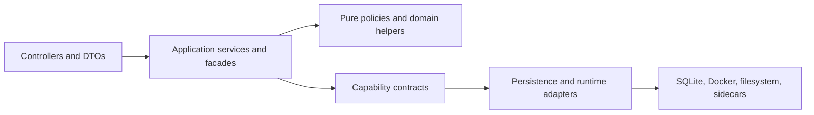
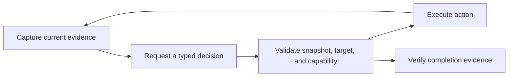

# Orchestrator architecture

The orchestrator is a single-host NestJS modular monolith. Android lifecycle changes, Docker
operations, network policy, and workflow runs need local coordination, so their use cases share
one process while keeping explicit domain boundaries. See the [system overview](architecture.md)
for the surrounding services.

## Dependency direction

Controllers validate and translate transport input. Application services coordinate use cases;
repositories own persistence; pure helpers own parsing, mapping, and policy. Cross-domain imports
use a domain's facade, contract, or module rather than reaching into its implementation.

## Domain map

| Domain                                                     | Responsibility                                                                                              |
| ---------------------------------------------------------- | ----------------------------------------------------------------------------------------------------------- |
| `android-apps`                                             | Definitions, profiles, stored state, lifecycle jobs, provisioning, runtime access, and viewer coordination. |
| `apk`                                                      | Safe upload storage, bounded inspection, metadata, and dependency analysis.                                 |
| `automations`                                              | Workflow definitions, triggers, execution, events, AI decisions, and perception.                            |
| `docker`                                                   | All container-engine adapters, retry policy, and runtime image metadata.                                    |
| `container-images` and `docker-maintenance`                | Image pull/build and patch jobs; runtime inventory and cleanup.                                             |
| `network-isolation` and `network-policy`                   | Runtime boundaries and firewall policy reconciliation.                                                      |
| `settings` and `feature-flags`                             | Runtime defaults, AI provider configuration, and revisioned feature intent.                                 |
| `scheduled-tasks`, `system-resources`, `health`, `metrics` | Maintenance schedules and operational observations.                                                         |
| `config`, `database`, `security`                           | Startup configuration, database connections, and request protection.                                        |

Submodules are code boundaries, not separate deployments. Docker consumers use tokenized interfaces
in `docker/contracts`. Automations use `ANDROID_APPS_AUTOMATION` from `android-apps/contracts`.
Ports declare independent capabilities; they must not derive their types from concrete services.

## Application lifecycle

Creating, starting, recreating the runtime, installing an APK, or removing an app reserves one persisted lifecycle job.
At most one job is active for an application. Each reservation has its own ID. The worker claims that ID,
and guarded progress, handoff, and completion apply only while the reservation still belongs to that worker.

- **Create and start** share runtime activation: resolve the image, prepare boundaries, create or start
  the container, apply network policy, and wait for Android readiness.
  The owner's open-app limit is checked in the same database transaction that records the new app
  or marks an existing one as starting. Clone, Recreate, and automation starts share that admission check.
  Restricted startup installs a temporary forwarding block on the managed IPv4 subnet before starting
  the container. The app's allowlist takes over after the firewall agent acknowledges it.
  The firewall agent persists removal ordering and the latest bulk snapshot timestamp so a stale refresh
  cannot reinstall a removed policy after restart.
  A container-scoped removal also fences stale first writes for that container.
  The agent stages changes on disk and publishes the new state only after the host accepts the rules.
- **Firewall recovery** inspects recorded restricted containers in Docker regardless of the application's
  stored status. A complete inventory can replace the firewall snapshot. While runtime identity,
  state, or policy is unresolved, recovery retries and refreshes verified live policies individually,
  preserving existing rules for unresolved runtimes. If retries are exhausted, recovery rechecks
  uncertain runtimes and attempts a stop only after confirming ownership, live state, and the same
  saved policy revision.
  Administrative reconciliation uses the same completeness check. Runtime teardown retains the
  container's firewall policy until Docker confirms removal.
- **Viewer policy refresh** serializes with app policy changes and reads the latest saved policy
  for the verified runtime. The agent accepts viewer refreshes only for the same enabled policy
  revision and container. Configuration writes advance the revision, and the agent remembers it
  after rule removal and restart.
- **Recreate** replaces the stopped or errored app's container and managed network, then uses the
  same activation path. It keeps profile volumes and owns its reservation through APK installation.
  Interrupted recreation is reported as an error so the operator can retry.
- **APK installation** receives a fresh reservation through a guarded handoff during Create or Start.
- **Profiles** retain persistent identities when temporary history rolls over. A new persistent name
  must resolve to unused storage. Existing names that share a volume retain access. Deletion preserves
  any volume still referenced by another saved or active persistent profile.
- **Stop** discards queued work and waits for in-flight runtime work to settle before looking up and stopping the
  container. Cancellation releases the worker's wait on a shared image pull.
- **Remove** drains existing work before reserving and performing bounded cleanup of runtime, network, volume, and
  viewer resources.
- **Startup recovery** follows the persisted job kind. Missing or inconsistent reservations become explicit errors
  rather than guessing work from application status.

Normal list/get operations read stored state only. Docker reconciliation is an explicit operation.
Viewer activity and policy observations update only their own fields and are scoped to the observed
runtime. The web console uses lifecycle acknowledgements for immediate feedback and follows the
application state to observe queued removal and startup completion.
The web service records metadata cleanup before requesting app removal. A bounded worker confirms
deletion before removing icon and recent-app metadata and retries pending work after a restart.
The owning lifecycle services and file-placement rules are listed in [AGENTS.md](../AGENTS.md).

## Workflow execution

A queued run reserves its target before preparation. The runner owns enqueue, cancellation, dispatch,
and abort controllers. The execution service prepares the target, runs steps, records metrics,
conditionally finalizes the run, and cleans up.
Target preparation authorizes either attaching or starting, then verifies the requested profile on the
ready runtime. The workflow captures Docker's start timestamp when it attaches. Android checks that
timestamp, the container ID, and the stored profile before admitting each device command and AI capture.
Runtime changes fence new admissions and drain work in progress. Cancellation stops new workflow
admissions and keeps the target reserved until admitted work settles, including in-flight ADB setup.
Docker inventory Stop and Remove use the same gate for managed Android containers.
An AI deadline can finish the decision while the workflow waits for a dispatched command to settle.
Workflow CIDR additions and removals use the latest stored allowlist inside the Android policy gate.

These are correctness guarantees:

- Only expected-status transitions may update a run; terminal state is never overwritten.
- One target cannot have competing queued or running automation runs.
- Event sequence allocation and insertion happen in the same transaction, backed by a unique run/sequence index.
  The Running transition and terminal transitions each commit with their corresponding event.
  Subscribers receive those events after commit.
- The orchestrator's SQLite adapter gives each query runner independent transaction state and
  coordinates access to the shared connection. Queries outside an open transaction wait for it to finish.
- Live listeners subscribe before replay. Replay reads bounded pages through a fixed sequence, then sends
  buffered live events in order and skips duplicates.
- Step results commit with their events, in execution order, and are assembled for run reads.
- Queued and running rows found at startup fail instead of resuming partially executed workflows.
- Workflow and trigger summaries use the newest queued run. Older runs can finish independently without replacing
  that summary. A trigger can also show a newer scheduled enqueue failure when the scheduler could not create a run.

## AI decisions

The harness owns budgets and the observe/act loop. Decision services call the provider;
the action executor validates grounded actions. Perception keeps screenshot capture, OCR,
model descriptions, and deterministic evidence fusion separate.

A controller turn exposes one decision schema or fallback tool. Mutations bind to the latest
snapshot and target; taps require an observed candidate or normalized coordinates. Completion
must cite known evidence. Compatibility normalization may repair provider envelopes, but cannot
invent grounding.
After dispatching a screen-changing action, require fresh evidence before the next decision, including
when the command response fails. If observation fails, the run reports a blocked outcome.

Raw ADB shell is not a default capability. Approved escalation validates an allowlisted read-only
command for one follow-up run. Provider streaming adapters preserve public results and usage
without storing hidden reasoning text. Provider reads enforce byte and frame limits through response
consumption. OCR validates the success envelope and deployment language before reporting detections.

The [AI automation README](../apps/orchestrator/src/automations/ai/README.md) covers usage,
decision kinds, provider/perception boundaries, and the implementation map.

## Image builds and settings

Managed GApps builds use one queued patch job at a time, a non-root worker without engine access,
verified revision-addressed caches, bounded extraction, and final image validation. Interrupted
running jobs fail rather than resume.
The Docker image runtime owns build stream errors, progress, and cancellation for custom, GApps,
and display sidecar image builds. Each caller still owns its context, validation, and job state.
The Docker worker adapter holds the GApps slot through cancellation and bounded worker cleanup.
APK storage serializes publication, catalog writes, and orphan removal for each content hash.

Settings persistence normalizes defaults; separate services own provider CRUD, connectivity checks,
and downloads. Transport protocol stays independent from detected server flavor.
Runtime Restore resets only the default image, registry, inactivity timeout, APK upload limit, and
optional service connections. Settings editors use the saved values returned by their writes.
Feature Restore uses the same deployment-aware defaults as first boot.

Maintenance schedules reserve execution before loading the task. Completion updates result fields and
recalculates the next run against the latest schedule. Configuration edits and removal can complete
during execution, and a late result preserves those changes. Persistence failures release the execution
reservation so a later manual run or cron tick can retry.

For local commands and verification, use the [contribution guide](../CONTRIBUTING.md).
API changes require regenerated contracts through `pnpm openapi:generate`.
