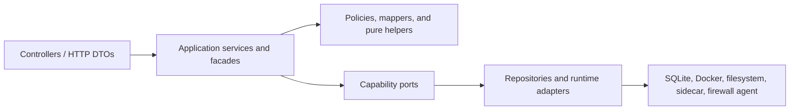
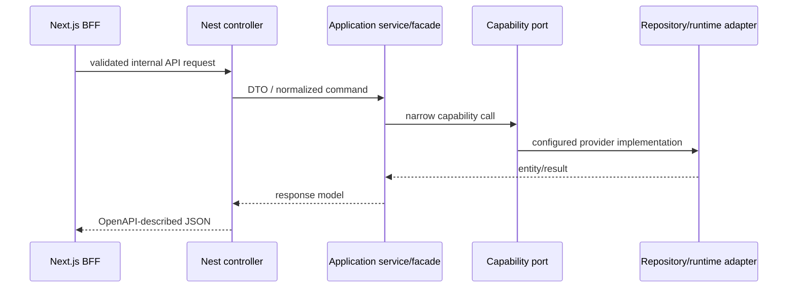
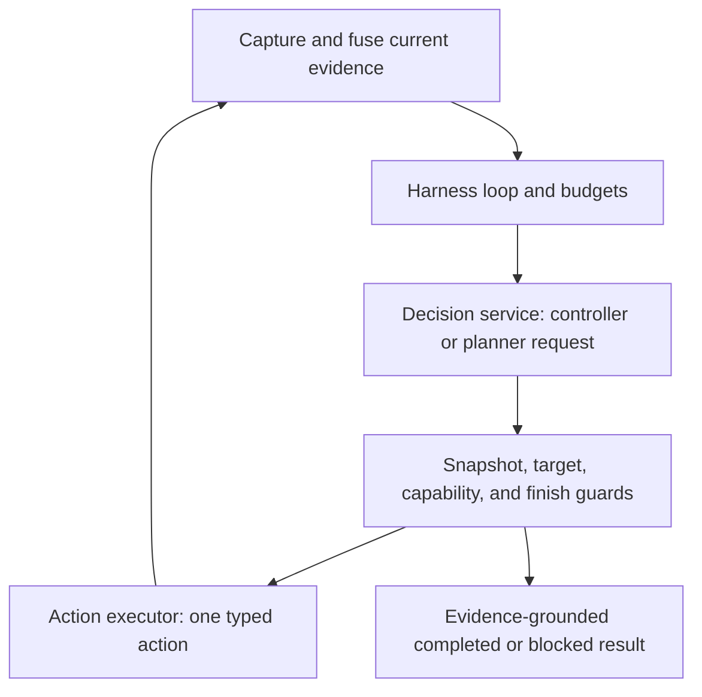

# Orchestrator architecture and contributor guide

## Architectural intent

The orchestrator is a single-host NestJS modular monolith. This is deliberate:
Android lifecycle state, Docker mutations, network policy, and automation runs
need local transactional coordination, but they do not need independent
deployment or a distributed consistency layer.

The architecture promotes domain ownership and capability boundaries:



Dependencies point inward toward use cases and contracts. A domain may import
another domain's facade, contract, or Nest module for wiring. It may not reach
through that boundary to use the other domain's repository, entity, controller,
or low-level adapter.

## Top-level module map

| Module | Owns | Public collaboration surface |
| --- | --- | --- |
| `android-apps` | Stored Android app state, profiles, lifecycle jobs, provisioning, runtime access, app network state, viewer coordination | `AndroidAppsFacadeService`, `ANDROID_APPS_AUTOMATION`, APK-reference and runtime-inventory ports |
| `apk` | Upload persistence, safe storage, bounded APK parsing, metadata and dependency analysis | controllers, `APK_CATALOG`, `APK_PACKAGE_INSPECTION` |
| `automations` | Definitions, triggers, schedules, execution, events, AI controller/planner, perception | `AutomationsService` and internal submodules |
| `docker` | Docker-compatible engine adapters and retry/error policy | tokens and interfaces in `docker/contracts` |
| `container-images` | Image inventory, pull/build, managed GApps patch jobs | module-owned services/controllers and Docker ports |
| `docker-maintenance` | Platform container/image/network inspection and pruning | focused maintenance application services/controllers |
| `network-isolation` | Deterministic app resource names and runtime boundaries | `NetworkIsolationService` |
| `network-policy` | Policy calculation and firewall-agent reconciliation | `NetworkPolicyService` consuming minimal targets |
| `settings` | Runtime settings, AI provider configuration/health/downloads | `SettingsService` plus focused internal services |
| `scheduled-tasks` | User-configured maintenance schedules and execution | `ScheduledTasksService` |
| `system-resources`, `health`, `metrics` | Operational observations | their controllers/services |
| `config`, `database`, `security` | Composition, state connection, request protection | application infrastructure |

Nest submodules inside `android-apps` and `automations` are code ownership
boundaries, not separately deployable services.

## Normal HTTP request flow



Controllers translate transport input and return DTOs. They do not orchestrate
repositories or runtime adapters. Application services own use-case ordering.
Pure validation, parsing, mapping, and policy decisions should be extracted only
when they are cohesive and independently testable.

## Android application lifecycle

Each application can have at most one active row in
`android_app_lifecycle_jobs`. The job kind is one of `provision`, `start`,
`install_apk`, or `remove`.

`AndroidAppsLifecycleTransitionService` owns status validation and commits the
application state plus job state/handoff in one SQLite transaction. Background
progress, failure, and completion are ignored when the job kind no longer
matches, which is how newer stop/remove requests defeat stale work.

### Create

1. `AndroidAppsConfigurationService` validates settings/APK ownership and saves
   the application definition.
2. It creates the `provision` reservation and schedules bounded background work.
3. `AndroidAppsProvisioningService` calls the shared
   `AndroidAppsRuntimeActivationService` for image, boundary, container,
   network-policy, and Android-readiness stages.
4. With no APK, the provision job completes as ready. With an APK, it is
   transactionally handed to `install_apk`.
5. `AndroidAppsApkInstallLifecycleService` installs and launches through the APK
   provisioning service, then completes the job.

### Start

1. `AndroidAppsPowerService` prepares profile/container settings and reserves
   `start`.
2. `AndroidAppsStartLifecycleService` uses the same runtime activation service
   as initial provisioning.
3. A missing attached APK hands the job to the same `install_apk` lifecycle;
   otherwise the installed app is launched and the start job completes.

### Stop and remove

- Stop cancels the tracker and active job in the same lifecycle transition that
  records `stopping`. It then stops Docker resources and records `stopped`.
- Remove cancels active work and replaces its reservation with `remove`.
  `AndroidAppsRemovalService` owns bounded retry; its cleanup collaborator owns
  Docker/network/volume/display teardown. Successful cleanup removes the app,
  logs, and job.

### Startup recovery

`AndroidAppsLifecycleRecoveryService` loads persisted jobs and resumes exactly
the recorded kind. It never guesses a job from application status. A job whose
kind disagrees with stored state, or a background state with no reservation, is
moved to an explicit error with diagnostics. Missing applications have their
orphaned jobs removed.

Normal application list/get operations remain storage-only. Call the explicit
runtime reconciliation endpoints when fresh Docker state is required.

## Automation execution and AI decisions

`AutomationsModule` composes definition, command, condition, event, runner,
scheduler, AI, and vision submodules. `AutomationsService` is intentionally the
controller-facing facade because the HTTP resource spans those related use
cases; detailed work stays in the focused services.

For a normal run:

1. `AutomationRunnerService` reserves the target in the queued database row,
   owns enqueue/cancel/dispatch, and creates the abort controller.
2. `AutomationRunExecutionService` performs target preparation, step execution,
   guarded terminalization, metrics, and cleanup.
3. Status transitions are conditional; terminal state cannot be overwritten.
4. Event sequence allocation and insertion are one transaction. Live listeners
   subscribe before replay and buffer/deduplicate during the handoff.

For `ai.run`:



`AutomationAiHarnessService` owns the deadline/action loop and controller state.
`AutomationAiDecisionService` owns provider decision/planner calls and message
construction. `AutomationAiActionExecutor` validates and executes grounded typed
actions and allowlisted shell escalation. Finish verification and plan parsing
are pure helpers. Every mutating action is bound to the latest snapshot and
target fingerprint; completion can cite only known evidence and completed
subgoals.

YAML draft wire events are defined once in `@rebroid/automation-core/yaml-draft`
and consumed by both orchestrator and Web without changing SSE event names.

## Code placement

| Code kind | Place it here |
| --- | --- |
| HTTP routing/Swagger | `controllers` and focused `dto` files |
| Controller-facing grouping | an intentional `*FacadeService` or existing resource service |
| Use-case ordering/background orchestration | focused `services` inside the owning domain |
| Cross-domain capability | independently declared interface/token in `contracts`; adapter wired with `useExisting` |
| Persistence details | `persistence`, `repositories`, and `entities` in the owning domain |
| Domain decision or validation | pure policy/helper close to the owning use case |
| Wire/entity mapping | `mappers` or a focused mapper service |
| Events and scheduling | `events` and `scheduler` |
| Framework composition | `*.module.ts` |

Do not add an app barrel or a re-export file to shorten imports. Do not extract a
one-line wrapper unless it is the intentional public facade for a domain. Prefer
a longer cohesive function to a chain of tiny indirections that hides ordering.

## Protected invariants

- Only `docker` implements engine behavior; consumers use its tokenized ports.
- APK and archive reads remain bounded and path-safe.
- Display-sidecar scrcpy/server/socket startup and cleanup ordering is not a
  cleanup target without a manual Redroid verification run.
- AI raw shell is denied by default and never appears in routed capabilities.
- Secrets are not returned in DTOs, logs, provider errors, or generated clients.
- The active lifecycle-job and active automation-target indexes are concurrency
  controls, not optional query optimizations.

## First contribution path

1. Identify the owning top-level module and read its Nest module file.
2. Trace controller to application service to contract/adapter; avoid starting
   from a repository and working outward.
3. Add a focused characterization test for behavior or ordering you will change.
4. Make the smallest cohesive edit. Update this guide or `AGENTS.md` if ownership
   or an invariant changes.
5. Run the owning checks from the repository root:

```sh
corepack pnpm --filter rebroid-orchestrator test
corepack pnpm --filter rebroid-orchestrator typecheck
corepack pnpm --filter rebroid-orchestrator lint
```

For DTO/controller changes, run `corepack pnpm openapi:orchestrator:check`. For
contracts or imports, run `corepack pnpm boundaries`. For a large or cross-app
change, finish with `corepack pnpm check`.
