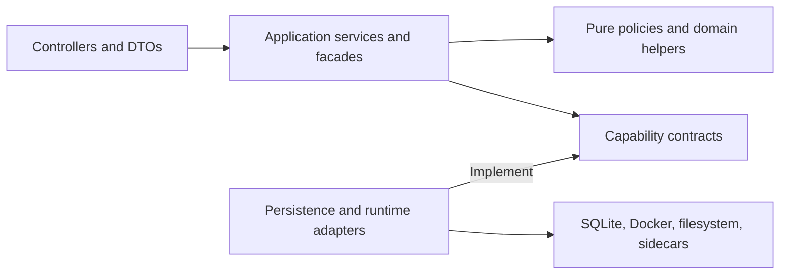

# Orchestrator architecture

The orchestrator is a single-host NestJS modular monolith. Android lifecycle changes, Docker
operations, network policy, and workflow runs need local coordination, so their use cases share
one process while keeping explicit domain boundaries. See the [system overview](architecture.md)
for the surrounding services.

## Dependency direction

Controllers validate and translate transport input. Application services coordinate use cases;
repositories own persistence; pure helpers own parsing, mapping, and policy. Cross-domain imports
use a domain's facade, contract, or module rather than reaching into its implementation.

## Domain map

| Domain                                                     | Responsibility                                                                                              |
| ---------------------------------------------------------- | ----------------------------------------------------------------------------------------------------------- |
| `android-apps`                                             | Definitions, profiles, stored state, lifecycle jobs, provisioning, runtime access, and viewer coordination. |
| `apk`                                                      | Safe upload storage, bounded inspection, metadata, and dependency analysis.                                 |
| `automations`                                              | Workflow definitions, triggers, execution, events, AI decisions, and perception.                            |
| `docker`                                                   | All container-engine adapters, retry policy, and runtime image metadata.                                    |
| `container-images` and `docker-maintenance`                | Image pull/build and patch jobs; runtime inventory and cleanup.                                             |
| `network-isolation` and `network-policy`                   | Runtime boundaries and firewall policy reconciliation.                                                      |
| `settings` and `feature-flags`                             | Runtime defaults, AI provider configuration, and revisioned feature intent.                                 |
| `scheduled-tasks`, `system-resources`, `health`, `metrics` | Maintenance schedules and operational observations.                                                         |
| `config`, `database`, `security`                           | Startup configuration, database connections, and request protection.                                        |

Submodules are code boundaries, not separate deployments. Docker consumers use tokenized interfaces
in `docker/contracts`. Automations use `ANDROID_APPS_AUTOMATION` from `android-apps/contracts`.
Ports declare independent capabilities; they must not derive their types from concrete services.

## Device catalog

The `/api/v1/devices` contract identifies every managed device by its durable ID, owner, and
`managed` kind. Its runtime image kind can be `redroid` or `generic`. The operation list describes
what the managed provider offers. Permissions, feature flags, and runtime health govern each request.
Catalog reads use SQLite state. The viewer authorization projection includes the stored runtime ID
only when the current managed runtime is marked running. External registrations live under
`/api/v1/devices/external` and bind viewer access to a verified attachment.

## Application lifecycle

Creating, starting, recreating the runtime, installing an APK, or removing an app reserves one persisted lifecycle job.
At most one job is active for an application. Each reservation has its own ID. The worker claims that ID,
and guarded progress, handoff, and completion apply only while the reservation still belongs to that worker.
The background job runner dispatches committed reservations. Diagnostic log writes report their own
failures, and a failed log write cannot strand a reservation or reverse a committed transition.

- **Create and start** share runtime activation: resolve the image, prepare boundaries, create or start
  the container, apply network policy, and wait for Android readiness.
  The owner's open-device limit is checked in the same database transaction that records the new app
  or marks an existing one as starting. Clone, Recreate, and automation starts share that admission check.
  Restricted startup installs a temporary forwarding block on the managed IPv4 subnet before starting
  the container. The app's allowlist takes over after the firewall agent acknowledges it.
  The firewall agent persists removal ordering and the latest bulk snapshot timestamp so a stale refresh
  cannot reinstall a removed policy after restart.
  A container-scoped removal also fences stale first writes for that container.
  The agent stages changes on disk and publishes the new state only after the host accepts the rules.
- **Firewall recovery** inspects recorded restricted containers in Docker regardless of the application's
  stored status. A complete inventory can replace the firewall snapshot. While runtime identity,
  state, or policy is unresolved, recovery retries and refreshes verified live policies individually,
  preserving existing rules for unresolved runtimes. If retries are exhausted, recovery rechecks
  uncertain runtimes and attempts a stop only after confirming ownership, live state, and the same
  saved policy revision.
  Administrative reconciliation uses the same completeness check. Runtime teardown retains the
  container's firewall policy until Docker confirms removal.
- **Viewer policy refresh** serializes with app policy changes and reads the latest saved policy
  for the verified runtime. The agent accepts viewer refreshes only for the same enabled policy
  revision and container. Configuration writes advance the revision, and the agent remembers it
  after rule removal and restart.
- **Recreate** replaces the stopped or errored app's container and managed network, then uses the
  same activation path. It keeps profile volumes and owns its reservation through APK installation.
  Interrupted recreation is reported as an error so the operator can retry.
- **APK installation** receives a fresh reservation through a guarded handoff during Create or Start.
- **Profiles** retain persistent identities when temporary history rolls over. A new persistent name
  must resolve to unused storage. Existing names that share a volume retain access. Deletion preserves
  any volume still referenced by another saved or active persistent profile.
- **Stop** discards queued work and waits for in-flight runtime work to settle before looking up and stopping the
  container. Cancellation releases the worker's wait on a shared image pull. The inactivity sweep
  defers busy runtimes and admits Stop only after the database confirms the same runtime is still
  running and overdue under its current timeout and viewer activity.
- **Remove** drains existing work before reserving and performing bounded cleanup of runtime, network, volume, and
  viewer resources.
- **Startup recovery** follows the persisted job kind. Missing or inconsistent reservations become explicit errors
  rather than guessing work from application status.

Normal list/get operations read stored state only. Docker reconciliation is an explicit operation.
The Apps gallery uses the same owner-scoped row projection for its initial render and refreshes.
Sidebar reads return only navigation fields and usually limit running results before sending rows to the web app.
The application detail page polls for lifecycle state and retrieves configuration when its revision changes.
Both responses use the current account's ownership and backend-detail permissions.
Live application log reads use the stored runtime reference. Lifecycle files and Docker streams have bounded tails.
ADB log requests also bound the command and cancel it when the sidecar client disconnects.
The diagnostics summary shares recent sidecar probes across callers and invalidates
firewall and OCR samples after settings changes. Full diagnostics still probes on request.
System resource overviews share aggregate work by Docker inventory revision. Docker stats sweeps rotate
by last attempt, including failures, and report partial coverage when the sampling budget expires.
Configuration commands write only the fields they own and reject changes to applications being removed.
Runtime settings that require replacement record that intent for the next Start. If settings change
during container creation, recording the new container preserves the replacement intent for the newer settings.
Viewer activity and policy observations update only their own fields and are scoped to the observed
runtime. Viewer heartbeats carry an opaque runtime version, and the orchestrator checks it with
the authenticated account's ownership before recording activity. The web console uses lifecycle acknowledgements
for immediate feedback and follows the application state to observe queued removal and startup completion.
The web service records metadata cleanup before requesting app removal. A bounded worker confirms
deletion before removing icon and recent-app metadata and retries pending work after a restart.
The owning lifecycle services and file-placement rules are listed in [AGENTS.md](../AGENTS.md).

### Running application snapshots

Snapshots are private, owner-scoped thumbnails of running managed apps. The bounded capture
sweep verifies the container and start time before publishing. Publish a replacement atomically
and keep the previous good capture if refresh fails. Reads require screenshot permission and
the same running runtime. Cleanup must preserve a newer capture.
[Snapshot service and storage](../apps/orchestrator/src/android-apps/runtime/services/android-apps-runtime-snapshot.service.ts)

### Android startup and attachment timing

After guarded startup and network policy installation, Android boot observation and display
sidecar attachment run concurrently. Join both before remote ADB setup or teardown, including
on cancellation. Reuse an attachment only while its reservation, runtime, network and sidecar
generation still match. Stop or Remove must drain a dispatched guest or Docker mutation.

Boot readiness requires both the guest properties and a running container in the same observation.
Early guest-shell unavailability can be retried within the boot deadline. Confirmed exits are
terminal. Remote ADB preparation has its own deadline. Provisioning propagates setup failures,
while a recovered viewer can still probe an existing transport.
[Boot observation](../apps/orchestrator/src/android-apps/provisioning/utils/android-boot-observation.ts) · [Diagnosing slow attachment](operations.md#slow-display-network-attachment)

## Workflow execution

A queued run reserves its target before preparation. The runner owns enqueue, cancellation, dispatch,
and abort controllers. The execution service prepares the target, runs steps, records metrics,
conditionally finalizes the run, and cleans up.
Target preparation authorizes either attaching or starting, then verifies the requested profile on the
ready runtime. For a managed target, the workflow captures Docker's start timestamp. Android checks it,
the container ID and the stored profile before each device command or AI capture. External runs
are bound to the verified attachment recorded at enqueue.
Runtime changes fence new admissions and drain work in progress. Cancellation stops new workflow
admissions and keeps the target reserved until admitted work settles, including in-flight ADB setup.
The runner retries the guarded cancellation write after admitted work drains. If the request's
attempts fail, the runner keeps retrying in the background until the run is terminal or the
orchestrator shuts down.
Docker inventory Stop and Remove use the same gate for managed Android containers.
An AI deadline can finish the decision while the workflow waits for a dispatched command to settle.
Workflow CIDR additions and removals use the latest stored allowlist inside the Android policy gate.

These are correctness guarantees:

- Only expected-status transitions may update a run; terminal state is never overwritten.
- One target cannot have competing queued or running automation runs.
- The queued reservation, its queued event and any initial AI prompt commit together.
  A failed admission write rolls back the reservation. Step and AI events require a running row.
- Event sequence allocation and insertion happen in the same transaction, backed by a unique run/sequence index.
  The Running transition and terminal transitions each commit with their corresponding event.
  Subscribers receive those events after commit.
- The orchestrator's SQLite adapter gives each query runner independent transaction state and
  coordinates access to the shared connection. Queries outside an open transaction wait for it to finish.
- Live listeners subscribe before replay. Replay reads bounded pages through a fixed sequence, then sends
  buffered live events in order and skips duplicates.
- Step results commit with their events, in execution order, and are assembled for run reads.
- Workflow run history reads summary rows with step counts. An open trace refreshes the selected run after committed
  step or status events, with a focused poll while event delivery reconnects.
- Queued and running rows found at startup fail instead of resuming partially executed workflows.
- Workflow and trigger summaries use the newest queued run. Older runs can finish independently without replacing
  that summary. A trigger can also show a newer scheduled enqueue failure when the scheduler could not create a run.
  Next-run bookkeeping failures are reported independently of run admission. Cron registrations follow
  committed trigger changes and preserve an active timer when its expression is unchanged.

## AI decisions

AI device tasks run inside the workflow runner’s reservation and authorization boundaries.
The controller proposes actions against the current snapshot. The executor checks grounding,
permissions and target identity before dispatch, then refreshes evidence after a screen change.
For decision budgets, completion evidence, provider roles and shell escalation, see
[AI automation](../apps/orchestrator/src/automations/ai/README.md).

## Image builds and settings

Managed GApps builds use one queued patch job at a time, a non-root worker without engine access,
verified revision-addressed caches, bounded extraction, and final image validation. Interrupted
running jobs fail rather than resume.
The Docker image runtime owns build stream errors, progress, and cancellation for custom, GApps,
and display sidecar image builds. Each caller still owns its context, validation, and job state.
The Docker worker adapter holds the GApps slot through cancellation and bounded worker cleanup.
APK storage serializes publication, catalog writes, and orphan removal for each content hash.
APK deletion commits the catalog change before unlinking shared bytes. Maintenance can retry
orphaned file cleanup.
Synchronous and asynchronous image pulls share admission and completion for the resolved image.
Docker archive uploads own the input stream, tar body, and engine request through cancellation and cleanup.

Settings persistence normalizes defaults; separate services own provider CRUD, connectivity checks,
and downloads. Transport protocol stays independent from detected server flavor.
Model downloads publish catalog entries only after the provider stream ends with a success event and a
check that the provider still uses the endpoint that served the download.
Runtime Restore resets only the default image, registry, inactivity timeout, APK upload limit, and
optional service connections. Settings editors use the saved values returned by their writes.
Feature Restore uses the same deployment-aware defaults as first boot.

Maintenance schedules reserve execution before loading the task. Completion updates result fields and
recalculates the next run against the latest schedule. Configuration edits and removal can complete
during execution, and a late result preserves those changes. Persistence failures release the execution
reservation so a later manual run or cron tick can retry.
The scheduler registers edits from the committed task snapshot, keeps an active timer when the
schedule is unchanged, ignores ticks from superseded registrations, and unregisters a removed task
after its deletion commits.

For API changes, follow the [contract generation steps](../CONTRIBUTING.md#openapi-contracts).
