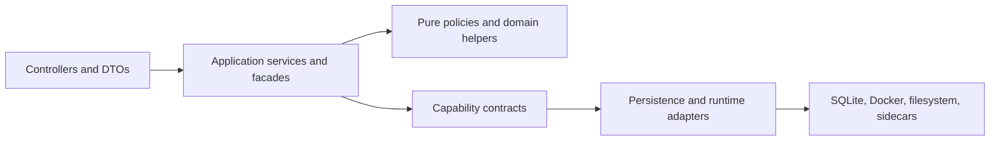
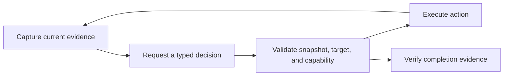

# Orchestrator architecture

The orchestrator is a single-host NestJS modular monolith. Android lifecycle changes, Docker
operations, network policy, and workflow runs need local coordination, so their use cases share
one process while keeping explicit domain boundaries. See the [system overview](architecture.md)
for the surrounding services.

## Dependency direction

Controllers validate and translate transport input. Application services coordinate use cases;
repositories own persistence; pure helpers own parsing, mapping, and policy. Cross-domain imports
use a domain's facade, contract, or module rather than reaching into its implementation.

## Domain map

| Domain                                                     | Responsibility                                                                                              |
| ---------------------------------------------------------- | ----------------------------------------------------------------------------------------------------------- |
| `android-apps`                                             | Definitions, profiles, stored state, lifecycle jobs, provisioning, runtime access, and viewer coordination. |
| `apk`                                                      | Safe upload storage, bounded inspection, metadata, and dependency analysis.                                 |
| `automations`                                              | Workflow definitions, triggers, execution, events, AI decisions, and perception.                            |
| `docker`                                                   | All container-engine adapters, retry policy, and runtime image metadata.                                    |
| `container-images` and `docker-maintenance`                | Image pull/build and patch jobs; runtime inventory and cleanup.                                             |
| `network-isolation` and `network-policy`                   | Runtime boundaries and firewall policy reconciliation.                                                      |
| `settings` and `feature-flags`                             | Runtime defaults, AI provider configuration, and revisioned feature intent.                                 |
| `scheduled-tasks`, `system-resources`, `health`, `metrics` | Maintenance schedules and operational observations.                                                         |
| `config`, `database`, `security`                           | Startup configuration, database connections, and request protection.                                        |

Submodules are code boundaries, not separate deployments. Docker consumers use tokenized interfaces
in `docker/contracts`. Automations use `ANDROID_APPS_AUTOMATION` from `android-apps/contracts`.
Ports declare independent capabilities; they must not derive their types from concrete services.

## Application lifecycle

Creating, starting, installing an APK, or removing an app reserves one persisted lifecycle job.
At most one job is active for an application. Application and job transitions are committed together;
late progress or completion is ignored after a newer operation takes ownership.

- **Create and start** share runtime activation: resolve the image, prepare boundaries, create or start
  the container, apply network policy, and wait for Android readiness.
- **APK installation** receives a guarded handoff when the runtime needs the attached package installed.
- **Stop** cancels active work before stopping runtime resources.
- **Remove** replaces the reservation and performs bounded cleanup of runtime, network, volume, and viewer resources.
- **Startup recovery** follows the persisted job kind. Missing or inconsistent reservations become explicit errors
  rather than guessing work from application status.

Normal list/get operations read stored state only. Docker reconciliation is an explicit operation.
The owning lifecycle services and file-placement rules are listed in [AGENTS.md](../AGENTS.md).

## Workflow execution

A queued run reserves its target before preparation. The runner owns enqueue, cancellation, dispatch,
and abort controllers. The execution service prepares the target, runs steps, records metrics,
conditionally finalizes the run, and cleans up.

These are correctness guarantees:

- Only expected-status transitions may update a run; terminal state is never overwritten.
- One target cannot have competing queued or running automation runs.
- Event sequence allocation and insertion happen in the same transaction, backed by a unique run/sequence index.
- Live listeners subscribe before replay, then buffer and deduplicate the handoff.
- Queued and running rows found at startup fail instead of resuming partially executed workflows.

## AI decisions

The harness owns budgets and the observe/act loop. Decision services call the provider;
the action executor validates grounded actions. Perception keeps screenshot capture, OCR,
model descriptions, and deterministic evidence fusion separate.

A controller turn exposes one decision schema or fallback tool. Mutations bind to the latest
snapshot and target; taps require an observed candidate or normalized coordinates. Completion
must cite known evidence. Compatibility normalization may repair provider envelopes, but cannot
invent grounding.

Raw ADB shell is not a default capability. Approved escalation validates an allowlisted read-only
command for one follow-up run. Provider streaming adapters preserve public results and usage
without storing hidden reasoning text.

## Image builds and settings

Managed GApps builds use one queued patch job at a time, a non-root worker without engine access,
verified revision-addressed caches, bounded extraction, and final image validation. Interrupted
running jobs fail rather than resume.

Settings persistence normalizes defaults; separate services own provider CRUD, connectivity checks,
and downloads. Transport protocol stays independent from detected server flavor.

For local commands and verification, use the [contribution guide](../CONTRIBUTING.md).
API changes require regenerated contracts through `pnpm openapi:generate`.
