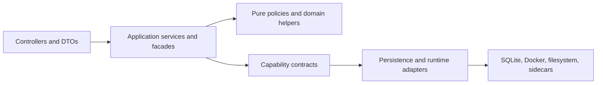
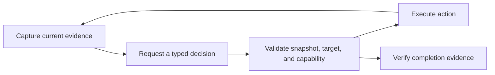

# Orchestrator architecture

The orchestrator is a single-host NestJS modular monolith. Android lifecycle changes, Docker
operations, network policy, and workflow runs need local coordination, so their use cases share
one process while keeping explicit domain boundaries. See the [system overview](architecture.md)
for the surrounding services.

## Dependency direction

Controllers validate and translate transport input. Application services coordinate use cases;
repositories own persistence; pure helpers own parsing, mapping, and policy. Cross-domain imports
use a domain's facade, contract, or module rather than reaching into its implementation.

## Domain map

| Domain                                                     | Responsibility                                                                                              |
| ---------------------------------------------------------- | ----------------------------------------------------------------------------------------------------------- |
| `android-apps`                                             | Definitions, profiles, stored state, lifecycle jobs, provisioning, runtime access, and viewer coordination. |
| `apk`                                                      | Safe upload storage, bounded inspection, metadata, and dependency analysis.                                 |
| `automations`                                              | Workflow definitions, triggers, execution, events, AI decisions, and perception.                            |
| `docker`                                                   | All container-engine adapters, retry policy, and runtime image metadata.                                    |
| `container-images` and `docker-maintenance`                | Image pull/build and patch jobs; runtime inventory and cleanup.                                             |
| `network-isolation` and `network-policy`                   | Runtime boundaries and firewall policy reconciliation.                                                      |
| `settings` and `feature-flags`                             | Runtime defaults, AI provider configuration, and revisioned feature intent.                                 |
| `scheduled-tasks`, `system-resources`, `health`, `metrics` | Maintenance schedules and operational observations.                                                         |
| `config`, `database`, `security`                           | Startup configuration, database connections, and request protection.                                        |

Submodules are code boundaries, not separate deployments. Docker consumers use tokenized interfaces
in `docker/contracts`. Automations use `ANDROID_APPS_AUTOMATION` from `android-apps/contracts`.
Ports declare independent capabilities; they must not derive their types from concrete services.

## Device catalog

The `/api/v1/devices` contract identifies every managed device by its durable ID, owner, and
`managed` kind. Its runtime image kind can be `redroid` or `generic`. The operation list describes
what the managed provider offers. Permissions, feature flags, and runtime health govern each request.
Catalog reads use SQLite state. The viewer authorization projection includes the stored runtime ID
only when the current managed runtime is marked running.

## Application lifecycle

Creating, starting, recreating the runtime, installing an APK, or removing an app reserves one persisted lifecycle job.
At most one job is active for an application. Each reservation has its own ID. The worker claims that ID,
and guarded progress, handoff, and completion apply only while the reservation still belongs to that worker.
The background job runner dispatches committed reservations. Diagnostic log writes report their own
failures, and a failed log write cannot strand a reservation or reverse a committed transition.

- **Create and start** share runtime activation: resolve the image, prepare boundaries, create or start
  the container, apply network policy, and wait for Android readiness.
  The owner's open-app limit is checked in the same database transaction that records the new app
  or marks an existing one as starting. Clone, Recreate, and automation starts share that admission check.
  Restricted startup installs a temporary forwarding block on the managed IPv4 subnet before starting
  the container. The app's allowlist takes over after the firewall agent acknowledges it.
  The firewall agent persists removal ordering and the latest bulk snapshot timestamp so a stale refresh
  cannot reinstall a removed policy after restart.
  A container-scoped removal also fences stale first writes for that container.
  The agent stages changes on disk and publishes the new state only after the host accepts the rules.
- **Firewall recovery** inspects recorded restricted containers in Docker regardless of the application's
  stored status. A complete inventory can replace the firewall snapshot. While runtime identity,
  state, or policy is unresolved, recovery retries and refreshes verified live policies individually,
  preserving existing rules for unresolved runtimes. If retries are exhausted, recovery rechecks
  uncertain runtimes and attempts a stop only after confirming ownership, live state, and the same
  saved policy revision.
  Administrative reconciliation uses the same completeness check. Runtime teardown retains the
  container's firewall policy until Docker confirms removal.
- **Viewer policy refresh** serializes with app policy changes and reads the latest saved policy
  for the verified runtime. The agent accepts viewer refreshes only for the same enabled policy
  revision and container. Configuration writes advance the revision, and the agent remembers it
  after rule removal and restart.
- **Recreate** replaces the stopped or errored app's container and managed network, then uses the
  same activation path. It keeps profile volumes and owns its reservation through APK installation.
  Interrupted recreation is reported as an error so the operator can retry.
- **APK installation** receives a fresh reservation through a guarded handoff during Create or Start.
- **Profiles** retain persistent identities when temporary history rolls over. A new persistent name
  must resolve to unused storage. Existing names that share a volume retain access. Deletion preserves
  any volume still referenced by another saved or active persistent profile.
- **Stop** discards queued work and waits for in-flight runtime work to settle before looking up and stopping the
  container. Cancellation releases the worker's wait on a shared image pull. The inactivity sweep
  defers busy runtimes and admits Stop only after the database confirms the same runtime is still
  running and overdue under its current timeout and viewer activity.
- **Remove** drains existing work before reserving and performing bounded cleanup of runtime, network, volume, and
  viewer resources.
- **Startup recovery** follows the persisted job kind. Missing or inconsistent reservations become explicit errors
  rather than guessing work from application status.

Normal list/get operations read stored state only. Docker reconciliation is an explicit operation.
The Apps gallery uses the same owner-scoped row projection for its initial render and refreshes.
Sidebar reads return only navigation fields and usually limit running results before sending rows to the web app.
The application detail page polls for lifecycle state and retrieves configuration when its revision changes.
Both responses use the current account's ownership and backend-detail permissions.
Live application log reads use the stored runtime reference. Lifecycle files and Docker streams have bounded tails.
ADB log requests also bound the command and cancel it when the sidecar client disconnects.
The diagnostics summary shares recent sidecar probes across callers and invalidates
firewall and OCR samples after settings changes. Full diagnostics still probes on request.
System resource overviews share aggregate work by Docker inventory revision. Docker stats sweeps rotate
by last attempt, including failures, and report partial coverage when the sampling budget expires.
Configuration commands write only the fields they own and reject changes to applications being removed.
Runtime settings that require replacement record that intent for the next Start. If settings change
during container creation, recording the new container preserves the replacement intent for the newer settings.
Viewer activity and policy observations update only their own fields and are scoped to the observed
runtime. Viewer heartbeats carry an opaque runtime version, and the orchestrator checks it with
the authenticated account's ownership before recording activity. The web console uses lifecycle acknowledgements
for immediate feedback and follows the application state to observe queued removal and startup completion.
The web service records metadata cleanup before requesting app removal. A bounded worker confirms
deletion before removing icon and recent-app metadata and retries pending work after a restart.
The owning lifecycle services and file-placement rules are listed in [AGENTS.md](../AGENTS.md).

### Running application snapshots

The orchestrator gives each minute's capture sweep a 45-second budget and admits up to four concurrent captures.
It rotates through owned running apps, alternating apps with an authorized preview request in the last two minutes
with a background pass ordered by the oldest capture attempt. Captures use the display sidecar's ADB screenshot command. It
reuses prepared ADB transport for up to five minutes when the verified container start time and address, policy
revision, and observed sidecar generation still match. A failed transport request invalidates readiness for the next
capture. Each capture verifies the Docker runtime again before publishing. The orchestrator
keeps one thumbnail per app as a WebP with a maximum edge of 480 pixels. Files are private and stored under
`runtime-snapshots` beside the orchestrator database. Refresh and cleanup check the previous file's metadata with a
bounded header read. A completed capture atomically replaces the previous file, and a failed capture preserves the
last valid thumbnail for the current runtime.
Stop clears the thumbnail when the app leaves the running state. Remove and runtime reconciliation also clear stale
thumbnails. Cleanup checks the current application state or the observed snapshot record before deleting, so a delayed
cleanup preserves a newer capture. Reads verify the current Docker container and start time. A separate cleanup pass
prunes snapshots for apps that are no longer eligible and temporary
files left by an interrupted write. An existing thumbnail remains available after an orchestrator restart if the same
Android runtime is still running.

`GET /api/bff/devices/{id}/runtime/snapshot` returns the WebP data URL and capture time in the standard operation
result. The web backend requires a current account with the screenshot permission. The orchestrator compares the
account ID from the authenticated web service against the app owner. A missing thumbnail or ownership mismatch
returns 404. Responses use `Cache-Control: private, no-store`.

### Android startup and attachment timing

After guarded container startup and network policy installation complete, Android
boot observation and display-sidecar network attachment run concurrently. Activation
joins both operations before starting remote ADB setup, including on failure or
cancellation, so Stop and Remove cannot race an admitted attachment. A recent
attachment is reusable only for the same reservation, runtime container, network,
and sidecar generation. Post-boot runtime and ADB target observations remain fresh.
Attachment observations older than three seconds are rechecked before ADB setup.
Transient attachment failures fall back to the normal post-boot retry loop. Time
waiting for attachment after boot consumes the existing remote-access deadline;
parallel work during boot does not consume that budget.

The application log records `Android network attachment completed` with the
reservation and runtime identity. `networkAttachmentMs` covers the entire attachment
including the sidecar FIFO. Its component fields separate `sidecarQueueMs`,
`sidecarPreparationMs` (discovery and any sidecar startup), `networkInspectMs`,
`dockerMutationQueueMs`, `networkConnectMs`, and `networkConvergenceMs` (verification
after an uncertain connect result). `Prepared Android remote access` records only
the work performed after boot; its nested `networkAttachment` timings capture any
attachment rechecks or retries. The concurrent attachment time must not be added to
boot time when calculating total startup latency.

Attachment timings also carry the observed sidecar container ID and, when the
existing inspection is available, its network count before attachment. When Docker
returns port mappings, `sidecarPublishedPortCount` counts published container
port/protocol entries and `sidecarPublishedBindingCount` counts their host bindings
(including separate IPv4/IPv6 bindings). Unpublished exposed ports do not count;
an absent port map leaves these fields absent. These observations reuse discovery's
inspection. The bounded
`networkConnect` observation describes the latest dispatched request: request ID,
container/network identity, transport kind, dispatch/settlement UTC timestamps,
and raw request outcome. A rejected request can still produce a verified successful
attachment after membership reconciliation. No extra Docker reads collect this
metadata. Debug events `docker_network_connect_dispatched` and
`docker_network_connect_settled` carry the same identity. The elapsed request time
includes client transport and daemon response; it is not a daemon-only measurement.

The orchestrator emits `android_boot_observation_settled` as soon as the boot branch
settles, before waiting for attachment to drain. Use its reservation, runtime and
UTC timestamp to distinguish early boot failure from attachment wait. For a slow
connect, correlate these records with Docker daemon logs/events for the same
container and network. Compare cold/warm runs and sidecar endpoint counts before
changing queue admission or caching. Never release a dispatched mutation early to
improve its reported duration.

Startup Docker work carries its remaining deadline and cancellation signal into
queue admission. Expired or cancelled entries are removed before dispatch. A
mutation already dispatched remains owned until it settles and any uncertain
network result is verified. Sidecar attachment and repair retain their ordering;
this does not increase Docker mutation concurrency.

Boot observation uses a monotonic budget and bounds each observation by the
remaining time, with a ten-second per-observation maximum. Unchanged properties
retain the one-to-three-second cadence, while container liveness is observed on
each iteration. Up to three consecutive transient observation failures are
allowed, within that same budget; verified missing or stopped containers and
permanent errors remain terminal. Readiness requires a successful current runtime
observation alongside Android properties. Before any successful guest probe, the
specific structured exit-255 `sh -lc` failure with stderr
`exec /bin/sh: no such file or directory` is treated as initial guest unavailability.
It retries within the full boot budget while checking fresh liveness, independently
of the three-failure transport limit. Other command failures remain terminal, and
this exception stops applying after a successful guest probe. The bounded
`android_guest_shell_unavailable` and `android_guest_shell_available` events record
the first unavailable and first subsequent successful observation, including elapsed
time and failure count, without logging every poll. Timeout diagnostics share a separate
five-second allowance and cancellation prevents further diagnostic work.

Each property probe reads one Android property snapshot and filters it inside
the guest to the readiness allowlist before returning output to Docker.
Each boot observation also emits the structured orchestrator event
`android_boot_probe`. It carries the application/container/reservation IDs, a
`bootObservationId`, sequence number, UTC observation timestamp, and monotonic
elapsed time. `properties` and `runtime` independently report their admission
queue time, admitted execution time, total time, outcome, and offsets from the
start of boot observation. Execution includes Docker client/daemon work and any
adapter retry or cleanup; it is not a measurement of guest execution alone.
An operation rejected before admission has `dispatched: false` and
`executionMs: null`. Backoff-only iterations report
`properties.outcome: skipped_backoff` while still measuring liveness.

`waitSincePreviousObservationMs` separates time between observations from Docker
work. `propertyReady`, `runtimeRunning`, `initialGuestShellUnavailable`, and
`cancelled` distinguish readiness, missing guest shell, and failed observations
without serializing commands, command output, or raw errors. The two operations
overlap, so do not sum their durations to calculate wall time. A fast, successful
probe with `propertyReady: false` establishes that Android had not reported ready
at that observation; a slow probe only bounds when readiness was observed. Compare
`properties.settledAfterMs` with the runtime settlement to identify liveness checks
that delayed accepting already-ready properties. The existing `Android boot
completed` entry records the last negative and first positive property sample
for the same runtime, including their sequence and monotonic timing offsets.

Set `REDROID_COLLECT_BOOT_EVENTS=true` on the orchestrator for a host timing run.
After Android remote access succeeds, a best-effort read records up to 32
allowlisted Android boot phase events as `android_boot_guest_events` in the
orchestrator output. It uses the Docker start timestamp from the existing
liveness read and the positive property sample's timestamp to filter the guest
event window. Events identify Android phases and are independent of the readiness
decision. Collection is off by default. It has one in-flight slot per orchestrator
and a two-second Docker deadline, and the lifecycle does not wait for it. With
collection enabled, the read can briefly occupy a shared Docker exec slot. Missing
events can reflect an unavailable or truncated guest event buffer.

Sidecar discovery remembers only the last observed container ID. Each use still
inspects the container; a missing ID falls back to exact-name discovery, and a
replacement or same-container restart invalidates the ADB generation. Running
state and network membership are not accepted from an old cached inspection.

Provisioning and recovered viewers share TCP-ADB guest preparation. It validates
the port, leaves an already-correct running adbd alone, and performs bounded
idempotent repair otherwise. Guest timeout is calculated after Docker queue
admission. Once guest mutation starts, its owner drains the bounded execution
before cancellation completes; cancelling a Docker stream alone cannot establish
guest exit. Provisioning still fails on unsuccessful setup, while viewer recovery
logs the setup failure and continues its existing ADB probe.

## Workflow execution

The Workflows grid reads summaries, nested step counts, and trigger target app IDs from
`GET /automations/grid`. The trigger picker uses `GET /automations/options` for metadata and
top-level step counts. The Run picker uses `GET /automations/runnable/options` for IDs and names.
Workflow detail reads include the full definition and editable YAML.

A queued run reserves its target before preparation. The runner owns enqueue, cancellation, dispatch,
and abort controllers. The execution service prepares the target, runs steps, records metrics,
conditionally finalizes the run, and cleans up.
Target preparation authorizes either attaching or starting, then verifies the requested profile on the
ready runtime. The workflow captures Docker's start timestamp when it attaches. Android checks that
timestamp, the container ID, and the stored profile before admitting each device command and AI capture.
Runtime changes fence new admissions and drain work in progress. Cancellation stops new workflow
admissions and keeps the target reserved until admitted work settles, including in-flight ADB setup.
The runner retries the guarded cancellation write after admitted work drains. If the request's
attempts fail, the runner keeps retrying in the background until the run is terminal or the
orchestrator shuts down.
Docker inventory Stop and Remove use the same gate for managed Android containers.
An AI deadline can finish the decision while the workflow waits for a dispatched command to settle.
Workflow CIDR additions and removals use the latest stored allowlist inside the Android policy gate.

These are correctness guarantees:

- Only expected-status transitions may update a run; terminal state is never overwritten.
- One target cannot have competing queued or running automation runs.
- The queued reservation, its queued event and any initial AI prompt commit together.
  A failed admission write rolls back the reservation. Step and AI events require a running row.
- Event sequence allocation and insertion happen in the same transaction, backed by a unique run/sequence index.
  The Running transition and terminal transitions each commit with their corresponding event.
  Subscribers receive those events after commit.
- The orchestrator's SQLite adapter gives each query runner independent transaction state and
  coordinates access to the shared connection. Queries outside an open transaction wait for it to finish.
- Live listeners subscribe before replay. Replay reads bounded pages through a fixed sequence, then sends
  buffered live events in order and skips duplicates.
- Step results commit with their events, in execution order, and are assembled for run reads.
- Workflow run history reads summary rows with step counts. An open trace refreshes the selected run after committed
  step or status events, with a focused poll while event delivery reconnects.
- Queued and running rows found at startup fail instead of resuming partially executed workflows.
- The web app reads replay pages through `GET /api/v1/automations/runs/:runId/events/page`. Drafting
  from an AI run reads the owner-scoped conversation through
  `GET /api/v1/automations/runs/:runId/events/conversation`.
- Workflow and trigger summaries use the newest queued run. Older runs can finish independently without replacing
  that summary. A trigger can also show a newer scheduled enqueue failure when the scheduler could not create a run.
  Next-run bookkeeping failures are reported independently of run admission. Cron registrations follow
  committed trigger changes and preserve an active timer when its expression is unchanged.

## AI decisions

The harness owns budgets and the observe/act loop. Decision services call the provider;
the action executor validates grounded actions. Perception keeps screenshot capture, OCR,
model descriptions, and deterministic evidence fusion separate.

A controller turn exposes one decision schema or fallback tool. Mutations bind to the latest
snapshot and target; taps require an observed candidate or normalized coordinates. Completion
must cite known evidence. Compatibility normalization may repair provider envelopes, but cannot
invent grounding.
After dispatching a screen-changing action, require fresh evidence before the next decision, including
when the command response fails. If observation fails, the run reports a blocked outcome.

Raw ADB shell is not a default capability. Approved escalation validates an allowlisted read-only
command for one follow-up run. Provider streaming adapters preserve public results and usage
without storing hidden reasoning text. Provider reads enforce byte and frame limits through response
consumption. OCR validates the success envelope and deployment language before reporting detections.

The [AI automation README](../apps/orchestrator/src/automations/ai/README.md) covers usage,
decision kinds, provider/perception boundaries, and the implementation map.

## Image builds and settings

Managed GApps builds use one queued patch job at a time, a non-root worker without engine access,
verified revision-addressed caches, bounded extraction, and final image validation. Interrupted
running jobs fail rather than resume.
The Docker image runtime owns build stream errors, progress, and cancellation for custom, GApps,
and display sidecar image builds. Each caller still owns its context, validation, and job state.
The Docker worker adapter holds the GApps slot through cancellation and bounded worker cleanup.
APK storage serializes publication, catalog writes, and orphan removal for each content hash.
APK deletion commits the catalog change before unlinking shared bytes. Maintenance can retry
orphaned file cleanup.
Synchronous and asynchronous image pulls share admission and completion for the resolved image.
Docker archive uploads own the input stream, tar body, and engine request through cancellation and cleanup.

Settings persistence normalizes defaults; separate services own provider CRUD, connectivity checks,
and downloads. Transport protocol stays independent from detected server flavor.
Model downloads publish catalog entries only after the provider stream ends with a success event and a
check that the provider still uses the endpoint that served the download.
Runtime Restore resets only the default image, registry, inactivity timeout, APK upload limit, and
optional service connections. Settings editors use the saved values returned by their writes.
Feature Restore uses the same deployment-aware defaults as first boot.

Maintenance schedules reserve execution before loading the task. Completion updates result fields and
recalculates the next run against the latest schedule. Configuration edits and removal can complete
during execution, and a late result preserves those changes. Persistence failures release the execution
reservation so a later manual run or cron tick can retry.
The scheduler registers edits from the committed task snapshot, keeps an active timer when the
schedule is unchanged, ignores ticks from superseded registrations, and unregisters a removed task
after its deletion commits.

For local commands and verification, use the [contribution guide](../CONTRIBUTING.md).
API changes require regenerated contracts through `pnpm openapi:generate`.
