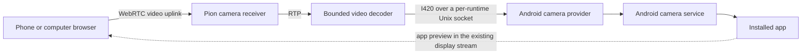

# Share a browser camera with an Android app

**Proposal, 21 November 2026.** Give the signed-in owner a **Share camera** action. The phone or computer browser captures video and sends it to Rebroid over WebRTC. One camera provider in the selected ReDroid runtime supplies those frames to Android. An installed app opens its usual camera preview, scans a code, or takes a picture through Camera2 or CameraX. This proposal assumes we want to support an unmodified APK. It has been checked against source code and has yet to run on a ReDroid host.

**Build the Android part first.** Pick one Android 14 image digest, host architecture, and real target app. Get that app to read a changing test pattern through its normal camera flow. A successful WebRTC call, an Android camera icon, or a visible Linux video device proves only one part of the path. In an upstream ReDroid report the container had two video device nodes while its camera provider listed zero devices. Google's Cuttlefish guest camera provider is a concrete starting point for serving frames received over a socket. [ReDroid issue #574](https://github.com/remote-android/redroid-doc/issues/574) · [Cuttlefish guest camera provider](https://android.googlesource.com/device/google/cuttlefish/+/cb86ee53d/guest/hals/camera/) · [Cuttlefish capture request implementation](https://android.googlesource.com/device/google/cuttlefish/+/master/guest/hals/camera/vsock_camera_device_session_3_4.cpp)

## Proposed media path

The upstream ReDroid 14 product makefile and device manifest do not select or declare a camera provider. Upstream describes porting Cuttlefish virtual HALs as planned work. Treat camera support as a property of the deployed image digest. This workspace has no Docker CLI, so the deployed image and target APK remain unverified. [ReDroid 14 product](https://github.com/remote-android/device_redroid/blob/redroid-14.0.0/redroid.mk) · [ReDroid 14 device manifest](https://github.com/remote-android/device_redroid/blob/redroid-14.0.0/manifest.xml) · [ReDroid WebRTC roadmap](https://github.com/remote-android/redroid-doc#webrtc-streaming)

| Component | Proposed first implementation |
| --- | --- |
| **Browser** | Capture in a dedicated top-level, same-origin camera page opened from the viewer. The person selects the camera and presses **Share with [app name]**. Use HTTPS and `getUserMedia({video: {facingMode: {ideal: "environment"}}, audio: false})`. Offer a local preview, a camera selector after permission, and **Stop sharing**. A phone can open this page while a desktop keeps the Android viewer open. Today Next.js sends `camera=()` globally. Give only the capture document `camera=(self)`, keep microphone disabled, and test the effective response at the HTTPS edge. Use a full document navigation to establish the page's policy. [Current web headers](../../apps/web/next.config.js) · [Current viewer iframe](../../apps/web/src/features/applications/viewer/display/display-viewer-frame.tsx) · [W3C media capture](https://www.w3.org/TR/mediacapture-streams/) |
| **WebRTC** | Open a separate camera-only peer connection, browser `sendonly`, receiver `recvonly`. The display peer already ties its H.264 negotiation and recovery to the scrcpy source. A separate peer lets the phone publish without receiving the desktop's display and lets camera failure end only camera sharing. Reuse the sidecar's authenticated signaling and Go bridge's UDP listener, with a distinct camera offer handler and peer budget. Require the WebRTC feature for camera sharing. A WebSocket display can stay open while a separate WebRTC camera uplink runs. [Viewer negotiation](../../apps/display-sidecar/src/modules/display/viewer/src/webrtc-stream.ts) · [Pion display peer](../../apps/display-sidecar/webrtc-bridge/peer.go) · [Deployment networking](../deployment.md) |
| **Decoder** | Start with one negotiated VP8 track, 640 × 480 at 15 fps. Request these as browser targets and enforce input and decoded-size limits at the receiver. Feed ordered RTP through a bounded jitter buffer, VP8 depayloader, decoder, scaler, and I420 conversion in a supervised, unprivileged worker. Pion receives compressed media. The present sidecar image needs the decoder and its runtime libraries added. GStreamer is a concrete first candidate. Drop incomplete frames, request a keyframe on loss, and replace stale decoded frames with the newest one. Negotiate H.264 later if the target phone matrix warrants a second decoder. [Pion GStreamer receiver example](https://github.com/pion/example-webrtc-applications/tree/main/gstreamer-receive) · [WebRTC video codecs](https://www.rfc-editor.org/rfc/rfc7742) · [Sidecar image](../../apps/display-sidecar/Dockerfile) |
| **Runtime transport** | Have the orchestrator provision a disposable per-runtime socket directory when it creates a camera-enabled runtime. Mount only that directory into the Android runtime and its paired worker. Send complete, length-prefixed frames over a Unix stream socket with a version, dimensions, format, monotonic timestamp, and publisher generation. Fix the first version to tightly packed I420. Bound the reader to one frame being filled and the latest complete frame. At the proposed size that is 460,800 bytes per frame and about 6.9 MB/s on the local host. Only compressed video crosses the phone's network. The orchestrator owns mounts and worker lifecycle through its Docker ports. [Container provisioning](../../apps/orchestrator/src/docker/containers/services/docker-container-provisioning.service.ts) |
| **Android camera** | Build a camera-enabled ReDroid variant for the pinned release. Port the frame-input portion of a matching AOSP camera provider to the Unix socket. The Cuttlefish reference uses a VM socket and includes platform-specific dependencies, so verify compatibility with the chosen release's camera interface and graphics allocator. Include the provider binary, init registration, VINTF manifest, feature declarations, socket access policy, and advertised stream configurations. Start with one stable rear-facing virtual camera if that is what the target app selects. Implement preview buffers, YUV analysis, and JPEG still capture using the latest frame, with correct strides, timestamps, rotation, and capture results. Advertise only implemented capabilities. [Android camera HAL](https://source.android.com/docs/core/camera/camera3) · [Cuttlefish guest sources](https://android.googlesource.com/device/google/cuttlefish/+/cb86ee53d/guest/hals/camera/) |

For the decoder worker, give the bridge and worker a private IPC endpoint for authenticated media from the admitted peer. The worker alone gets the directory for the selected Android runtime. Have the orchestrator allocate both endpoints from trusted runtime state and clean them up after each runtime generation. Keep credentials and camera buffers out of persistent profile volumes. Give the decoder a memory limit and a maximum input resolution before frame allocation. A 640 × 480 capture preference in the browser alone cannot bound receiver resource use.

## How sharing should behave

- **Same device.** Open the camera page from the viewer, select the front or rear camera, grant browser permission, and start sharing. For a single-phone workflow, the capture page must also host or retain the Android viewer in the foreground so switching back to the app preview does not background capture. Keep a visible sharing indicator and stop button. Switching the physical source can feed the same virtual Android camera ID. Test portrait orientation, front-camera mirroring, camera switching, and permission denial on real phones. Mirror only the local selfie preview where appropriate. [Media capture constraints and tracks](https://www.w3.org/TR/mediacapture-streams/)
- **Phone as camera, desktop as viewer.** Offer a camera-page link or QR code for the selected runtime. Require the same signed-in owner on the phone and show the destination app and profile before capture. The link identifies the destination. Issue a short-lived publish grant only after server authorization. Start with one publisher per runtime and show “Camera already shared” to a second publisher.
- **Scope and consent.** Give camera publishing its own permission. Bind the grant to the publishing account session, owner, runtime container ID, active profile, and publisher generation. The Android app still needs its own camera permission. An Android camera belongs to the runtime and may be opened by another permitted Android app there. Describe that scope in the sharing UI. Raw frames remain in memory. The target app can save a picture if the user asks it to.
- **Stop and recovery.** On Stop, end the local media tracks and peer, revoke the lease, discard buffered frames, and clear the provider's last image. Output a neutral camera-off frame while idle, including after worker failure. The provider needs its own freshness timeout for abrupt mobile network loss. Stop on sign-out, revocation, profile change, runtime replacement, page closure, or publisher expiry. A replacement generation must reject frames from its predecessor. After phone backgrounding or lock, show an explicit resume action if capture ended. Camera failure must leave the existing display and controls usable.
- **Phone connectivity.** Start on an HTTPS LAN endpoint the phone trusts and can reach. For access over cellular or restricted Wi-Fi, support authenticated TURN with short-lived credentials and test a relay-only call. The current deployment has a published UDP port and STUN settings. A mobile browser reaching the website establishes only HTTPS reachability. [Current WebRTC deployment](../deployment.md) · [Sidecar STUN configuration](../../apps/display-sidecar/src/modules/shared/sidecar-config.service.ts) · [WebRTC TURN guidance](https://webrtc.org/getting-started/turn-server)

## Implementation milestones and exit criteria

1. **Prove the Android consumer.** On a native Linux ReDroid host, record the exact image digest and ABI. Inspect `adb shell dumpsys media.camera`, provider registration and camera feature declarations. Run a Camera2 probe that enumerates IDs, lens facing, output formats and supported sizes. Then open the target APK's camera flow. If an existing provider already supports an isolated frame source, use it. Otherwise build the socket-backed image variant, push a moving color chart with a timestamp through its socket, and check preview, QR analysis, JPEG capture, and close/reopen. A changing, correctly oriented image inside the actual app is the first go/no-go result. [Android camera samples](https://github.com/android/camera-samples) · [ReDroid camera integration reports](https://github.com/remote-android/redroid-doc/issues/174)
2. **Prove the phone path on LAN.** Replace the chart producer with the camera peer and decoder. Run Chrome on Android, Safari on iPhone, and a desktop webcam. Read a printed QR code from the shared camera and save one photo inside the container app. Measure camera-to-app latency and phone-to-viewer round-trip latency separately. Initial acceptance targets are 15 fps, a camera-to-app latency below 500 ms at p95, and a ten-minute run without a growing frame queue. Record CPU, peak memory, actual codec, orientation and dimensions.
3. **Integrate the runtime lifecycle.** Gate the feature by image digest, receiver availability, WebRTC availability, and the owner's publishing permission. Stop sharing while the camera is open, kill the worker, unplug a webcam, revoke the account session, and switch profiles. Confirm that the provider clears the last personal frame within a proposed one-second freshness limit, display streaming continues, and an old publisher cannot feed a new runtime. Test concurrent publishers on two runtimes with visually distinct sources.
4. **Expand compatibility.** Add front-facing Android enumeration if target apps require that selector. Verify each further ReDroid image and ABI separately. Test CameraX and any legacy Camera1 app that matters to the deployment. Verify mobile data through TURN before claiming remote-phone support. Track hardware-dependent features such as autofocus, torch, and depth as explicit capability gaps.

## When a Linux loopback camera is enough

For a single trusted test runtime, a decoder writing to `v4l2loopback` can shorten the Android spike **if** the pinned image includes a suitable camera provider and the target APK accepts the lens facing it exposes. Configure the writer first, check the node's actual capture capabilities, supported pixel formats, discrete sizes and frame intervals, then confirm Android enumeration and app preview. If the provider rejects the node or the app insists on a rear-facing Camera2 device, move to the socket-backed image. ReDroid runs privileged containers, so naming a different host video node per runtime is insufficient evidence of camera isolation across tenants. [AOSP external camera requirements](https://source.android.com/docs/core/camera/external-usb-cameras) · [v4l2loopback device capabilities](https://github.com/v4l2loopback/v4l2loopback) · [ReDroid integration experience](https://github.com/remote-android/redroid-doc/issues/574)

If the target APK is under your control and only needs frames inside its own UI or scanner, integrating a WebRTC receiver directly into that app is a smaller project. For unmodified APKs, the managed camera provider is the part that makes the incoming stream an Android camera. scrcpy's camera option captures an existing Android camera and streams it out to the viewer. [scrcpy camera documentation](https://github.com/Genymobile/scrcpy/blob/v5.0.1/doc/camera.md)
